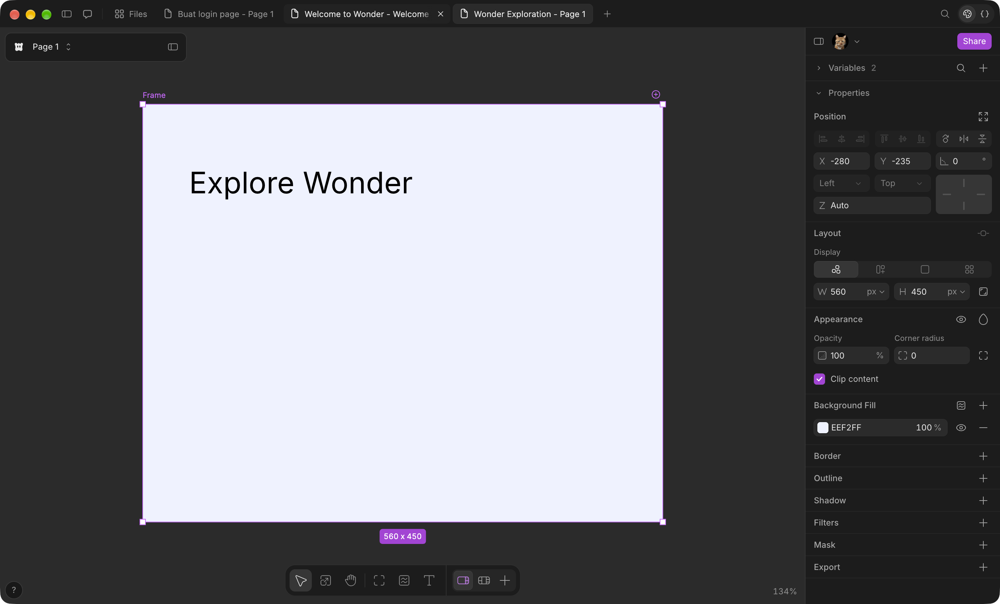
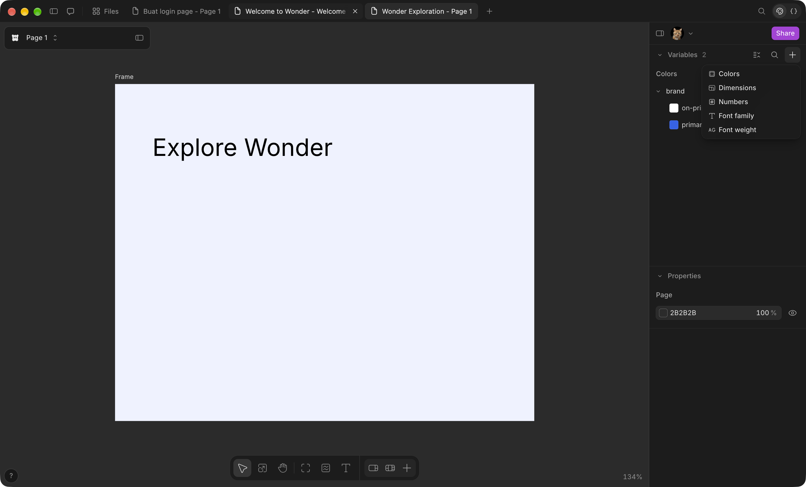
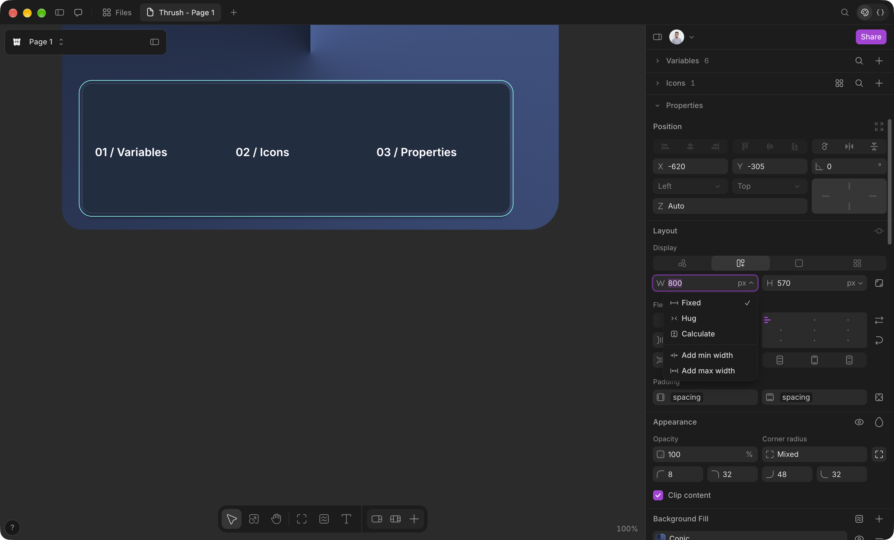

# Audit Properties dan pengikatan variable — 30 Oktober 2026

Penanggung jawab: agent `audit_properties`. Cakupan: inspector Verynize, hubungan variable dengan nilai yang dirender, dan referensi Wonder yang sudah tersimpan. Agent ini tidak mengoperasikan Wonder; observasi dan capture Wonder pada sesi aktif dilakukan agent utama. Screenshot baru dari sesi itu diperiksa sebagai referensi implementasi.

## Sumber dan batas bukti

- Screenshot historis yang diperiksa langsung: [43-frame-properties.png](../../design/wonder/43-frame-properties.png), [42-new-variable-menu.png](../../design/wonder/42-new-variable-menu.png).
- Bukti sesi aktif yang diperiksa langsung: [29-individual-corners.png](../../design/wonder/2026-10-30/29-individual-corners.png), menampilkan radius individual 8/32/48/32 dan nilai uniform “Mixed”.
- Spesifikasi referensi: [wonder-canvas-spec.md §3](../wonder-canvas-spec.md#3-inspector-right-panel-o-screenshots-22254356-plus-bundle-headings). Label observasi/inferensi di dokumen asal tetap berlaku.
- Implementasi: `web/src/islands/inspector/`, `web/app.js`, `web/node-style.js`, `integrations/design-edit.mjs`.
- Screenshot historis membuktikan keberadaan kontrol pada waktu capture, bukan hasil interaksi pada Wonder hari ini. Tidak ada klaim bahwa seluruh konfigurasi Wonder sudah dicoba.

## Temuan dan perbaikan

### P1 — Melepas color variable mengubah warna yang terlihat

Sebelum perbaikan, `VariableMenu` di `web/src/islands/inspector/properties.tsx` menjalankan `setField(selection, node, "token", "")`. Renderer (`web/app.js:19`) memilih `design.tokens[n.token] || n.color`; mengosongkan token membuat layer kembali ke warna lokal lama. Contoh: warna lokal merah, token biru transparan → Detach variable menghasilkan merah.

Perbaikan pada `properties.tsx`, fungsi `VariableMenu`: setiap layer yang dipilih menerima warna token terkini sebagai `color` sebelum `token` dikosongkan, dalam satu edit undoable. Alpha dipertahankan. Multi-selection mempertahankan warna masing-masing; token yang hilang mempertahankan fallback lokal. Penghapusan color variable sebelumnya sudah benar karena handler `web/app.js:20` menyimpan nilai resolved sebelum menghapus referensinya.

### P1 — Chip variable aktif tetapi override lama tetap menang saat rendering

Sebelum perbaikan, `bindVariable` pada `vars.ts` hanya menulis scalar dan nama binding. Renderer memberi prioritas pada `cornerRadii`, `strokeWidths`, `paddingTop/Right/Bottom/Left`, dan `gapX/Y` (`web/node-style.js:173`, `:177`, `:236`, `:239`). Akibatnya, binding radius 24 masih dapat terlihat sebagai empat radius 4/8/12/16.

Reproduksi headless menggunakan fungsi produksi `syncVariables` dan `nodeStyle` menghasilkan:

| Properti | Scalar setelah sync | Nilai CSS sebelum perbaikan bind |
|---|---|---|
| radius | 24 | `4px 8px 12px 16px` |
| strokeWidth | 24 | `1px 2px 3px 4px` |
| padding | 24 | `5px 5px 5px 5px` |
| gap | 24 | column `7px`, row `9px` |

Perbaikan pada `vars.ts:224`: pemasangan binding scalar membersihkan override yang bertentangan melalui helper `scalarOverrides` di `model.ts`. Gap mengikuti kontrak kontrol `layout.tsx:430`: main axis flex, atau column gap untuk grid. Override cross axis tetap dipertahankan. Detach hanya melepas binding dan mempertahankan hasil yang sudah dirender.

Batas: perbaikan ini berlaku ketika pengguna memasang binding melalui inspector. Dokumen lama yang sudah menyimpan kombinasi binding dan override yang bertentangan belum dimigrasi; headless `syncVariables` masih mempertahankan override. Kebijakan migrasi perlu ditentukan terpisah agar spacing independen tidak terhapus secara luas.

### P2 — Cakupan pengikatan masih terbatas

`vars.ts:26` menyediakan sepuluh properti typed binding: radius, gap, padding, strokeWidth, fontSize, letterSpacing, lineHeight, opacity, fontFamily, fontWeight. Color token memakai jalur `node.token` yang hanya mencakup fill/ink utama. Warna border pada `properties.tsx` memakai `ColorPopover` tanpa `tokens`/`onToken`; tidak ada binding warna border, warna gradient stop, shadow, maupun halaman. W/H, posisi, radius per corner, dan padding per side juga belum memiliki binding tersendiri. Ini merupakan batas fitur nyata, bukan klaim bahwa Wonder mengizinkan setiap kombinasi tersebut tanpa observasi lanjutan.

### P2 — Kontrol Properties belum mencakup seluruh referensi

`PropertiesBody` (`properties.tsx`) merender Position, Layout, Appearance, Typography, Fill, Border, Shadow, Mask, Export, Layer dan Page. Screenshot historis Wonder memperlihatkan Outline dan Filters; dua bagian ini belum tersedia. Pada awal audit kontrol radius dan border masih uniform. Setelah bukti sesi aktif diperiksa, inspector kini memiliki editor per-corner dan per-side menggunakan tuple yang sudah didukung renderer. Fill masih satu warna utama dengan satu field CSS gradient, bukan stack paint dengan add/remove/visibility per paint.

Temuan lanjutan pada pengetikan scalar langsung juga diperbaiki: `model.ts:setField` kini memakai helper `scalarOverrides` yang sama seperti binding, sehingga pengetikan uniform radius/border membersihkan `cornerRadii`/`strokeWidths`. Regression memeriksa nilai CSS yang terlihat dan satu undo mengembalikan nilai individual. Helper juga mencakup padding dan main-axis gap agar aturan pengikatan tidak terpisah dari aturan edit scalar.

### Implementasi tambahan — Radius individual dan border per sisi

[Capture Wonder sesi aktif](../../design/wonder/2026-10-30/29-individual-corners.png) memperlihatkan empat radius 8/32/48/32. Editor Verynize kini memiliki tombol **Independent corner radii** dan empat field TL/TR/BR/BL; uniform field tetap tersedia dan menampilkan “Mixed” jika nilainya berbeda. Border memiliki tombol **Independent border widths** dan empat field T/R/B/L. Kehadiran per-side border mengikuti spesifikasi historis; tidak diklaim terlihat pada screenshot 29.

Membuka editor individual dari nilai bound menyalin nilai resolved ke empat sisi/corner dan melepas hanya binding uniform terkait dalam satu langkah undo. Mengedit satu sisi tidak mengubah sisi lain atau binding properti lain. Menutup editor menyembunyikan field tanpa mengubah geometri. Mengetik uniform atau memasang ulang variable uniform membersihkan override individual. Nilai negatif di-clamp ke nol; nilai tidak finite/blank ditolak. Binding per-corner/per-side belum ditambahkan.

### P1 — Native raster export memperbesar file, tetapi artwork tetap 1×

Agent `audit_variables_icons` menemukan output workflow berukuran 1600×1140 untuk export 2×, tetapi artwork 800×570 hanya mengisi pojok kiri atas. Agent audit properties kemudian memeriksa gambar tersebut langsung dan menyimpan [bukti sebelum perbaikan](../../design/verynize/2026-10-30/workflow-export-before-scale-fix.png). Audit `desktop/render.cjs:renderNow` menemukan `setZoomFactor(scale)` dipanggil sebelum `loadURL(data:...)`; zoom yang dipasang pada halaman awal dapat berubah saat konteks navigasi baru terbentuk.

Patch memindahkan `setZoomFactor(scale)` setelah `await loadURL(...)`, sebelum menunggu font/image serta dua animation frame. Ukuran output, policy jaringan, sandbox dan cleanup window tetap menggunakan jalur yang ada. Context7 di-resolve ke `/electron/electron` lalu query versi 42.0.0 untuk [webContents.setZoomFactor](https://github.com/electron/electron/blob/v42.0.0/docs/api/web-contents.md#contentssetzoomfactorfactor) dan [capturePage](https://github.com/electron/electron/blob/v42.0.0/docs/api/browser-window.md#wincapturepagerect-opts). Dokumentasi memastikan kontrak API; reset pada navigasi ini merupakan diagnosis dari urutan kode dan bukti runtime, bukan kutipan eksplisit dari dokumentasi.

Test lama hanya memeriksa dua pixel dan `body background:blue`, sehingga background body yang memenuhi viewport bisa menyamarkan artwork yang tidak terskala. `tests/render-export.cjs` kini memakai body transparan dan dua kotak eksplisit, memeriksa pixel atas/bawah di kedua sisi pada 0.5×, 1×, 2×, 4×, ukuran PNG, serta layout boxes yang tetap dalam CSS pixel. Syntax check dan regression Electron lulus. Agent pemegang desktop menjalankan `node tests/render-export.cjs` pada build terbaru: skala 0.5×/1×/2×/4× lolos ukuran dan pemeriksaan pixel cakupan. [Export workflow setelah perbaikan](../../design/verynize/2026-10-30/workflow-export.png) telah dibuat ulang pada 1600×1140 dan diperiksa visual; artwork memenuhi frame. [Metadata verifikasi](../../design/verynize/2026-10-30/export-verification.json) mencatat pixel opaque pada area kanan dan bawah, delapan layer, serta SVG tint.

## Matriks cakupan

| Area | Bukti Wonder | Verynize saat audit | Status/pengujian yang diperlukan |
|---|---|---|---|
| Page background | Screenshot awal sesi user, referensi 42 | Warna dan alpha halaman | Ada; variable halaman belum didukung |
| Position, constraints, z-index | Referensi 43 | Kontrol tersedia | Flow/absolute perlu observasi Wonder lanjutan |
| Free/flex/grid/block layout | Spesifikasi §3 | Layout, axis, wrapping, alignment, gap | Ada; binding gap diperbaiki untuk override |
| W/H modes, min/max | Spesifikasi §3 | Sebagian mode dan min/max | Audit UI modes lengkap di luar perbaikan ini |
| Padding/margin per axis/side | Spesifikasi §3 | Per-axis/per-side tersedia | Binding padding uniform diperbaiki |
| Opacity, clip | Referensi 43 | Number binding dan clip frame | Ada, test inspector lama |
| Radius | Referensi 43 + capture aktif 29 | Scalar binding dan empat editor corner | Implementasi dan regression CSS/undo lulus |
| Font family/weight/size | Referensi 42 dan spesifikasi | Typed binding tersedia | Test inspector lama; batas font-size tidak seragam |
| Fill dan color variable | Referensi 43 | Fill utama, alpha, gradient CSS | Detach diperbaiki; paint stack belum |
| Border | Referensi 43 dan spesifikasi | Uniform width bindable + per-side width, warna literal | Editor per-side selesai; color binding belum |
| Outline/Filters | Referensi 43 | Tidak dirender PropertiesBody | Gap eksplisit |
| Shadow/Mask | Referensi 43 | Field CSS | Structured editor dan variable subproperti belum |
| Export | Referensi 43, spesifikasi §3 | PNG/JPEG/WebP/SVG/PDF/HTML; urutan zoom native diperbaiki | Regression raster 0.5/1/2/4× lulus, termasuk pixel cakupan |
| Variable types | Referensi 42 | Colors + Dimensions + Numbers + Font family + Font weight | Kelima jenis tersedia |
| Icons | Screenshot awal sesi user | Panel terpisah | Audit agent `audit_variables_icons` |

## Validasi

- `node --test integrations/variables.test.mjs integrations/node-style.test.mjs`: 11/11 lulus pada audit awal, sebelum perubahan agent lain pada test variable. Tidak membuka desktop.
- `npm run lint:ui`: lulus pada pemeriksaan awal patch.
- `node --check tests/inspector-variable-binding.cjs`: lulus.
- `npm run typecheck:ui`: lulus setelah agent pemilik memperbaiki error sementara `legacy.ts:78` pada perubahan yang sedang berlangsung.
- Regression UI baru: `node tests/inspector-variable-binding.cjs`. Menggunakan Electron asli dan interaksi inspector, memeriksa warna/alpha, mixed selection, missing token, undo/redo/reload, pengetikan uniform radius/border, editor individual corner/border, radius/border/padding overrides, main/cross axis, dan detach numeric. Lulus pada build terbaru menurut hasil definitif agent `audit_variables_icons`, yang mendapat giliran desktop setelah sesi Wonder. Bukti [radius individual](../../design/verynize/2026-10-30/01-individual-corners.png) dan [border individual](../../design/verynize/2026-10-30/02-individual-border-widths.png) telah disimpan.
- `npm run build:ui` lulus sebelum regression akhir. Agent integrator sudah memasukkan `inspector-variable-binding.cjs` dan `inspector-variable-library.cjs` ke `test:canvas`, dengan mempertahankan perubahan pengguna pada `package.json`.

## Rekomendasi urutan berikutnya

1. Lanjutkan cakupan Wonder yang belum diuji dalam [dokumentasi workflow](../wonder-design-workflow-2026-10-30.md); 43 screenshot, export PNG, rename/delete/Undo variable dan ikon child absolute sudah direkam.
2. Tambahkan binding per-corner/per-side setelah model dan semantiknya ditentukan; editor nilai individual dan regression CSS/undo sudah lulus.
3. Rancang paint stack dan binding color per properti sebagai perubahan schema konsisten antara renderer, export, codec dan MCP; hindari sekadar menampilkan kontrol yang tidak punya perilaku.

Pemeriksaan hidden-window: tidak ditemukan mode pengujian tersembunyi pada infrastruktur yang ada. `desktop/main.cjs` membuat BrowserWindow langsung; hide setelah launch masih berisiko mengambil fokus. Karena itu regression Electron semula ditunda sampai agent utama menyatakan desktop bebas, tanpa mengubah default visibility produk. Setelah giliran desktop diberikan, seluruh regression relevan di bawah ini selesai dan lulus.

Untuk bukti produk dari regression: set `BD_WONDER_EVIDENCE_DIR` ke direktori output; test menyimpan `01-individual-corners.png` dan `02-individual-border-widths.png` setelah interaksi dan assertion CSS yang terkait. Screenshot opsional ini tidak dibuat pada run rutin tanpa environment variable tersebut.

- Tambahan validasi native export: `node --check desktop/render.cjs` dan `node --check tests/render-export.cjs` lulus.

## Validasi akhir terkoordinasi

Agent pemegang desktop melaporkan hasil definitif pada build UI terbaru: `tests/inspector-variable-binding.cjs`, `tests/inspector-variable-library.cjs`, `tests/canvas-page.cjs`, `tests/inspector-parity.cjs`, dan `tests/render-export.cjs` semuanya lulus. Pemeriksaan parity mencakup PNG 0.5×/4× dan PDF; render-export mencakup ukuran serta pixel artwork pada 0.5×/1×/2×/4×. Semua aplikasi Electron pengujian telah ditutup.

Agent utama juga mengonfirmasi `npm run check`, `npm run lint:ui`, `npm run typecheck:ui` lulus pada pemeriksaan akhir, integrasi terpilih 116/116 lulus, dan fidelity 26 fixture / 105 pemeriksaan lulus. Ini validasi terarah, bukan pernyataan bahwa seluruh `npm test` dijalankan.
