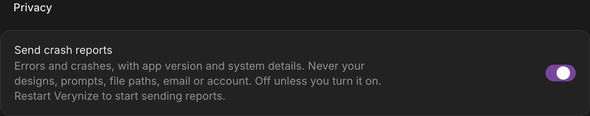

# Crash reports (Sentry)

Verynize reports errors and crashes to Sentry from four places. Client reporting is **opt-in**: nothing is set up
or sent until the user turns on **Settings › Preferences › Privacy › Send crash reports**.

| Surface                                             | Sentry project                    | SDK                           | Started in                                                                               |
| --------------------------------------------------- | --------------------------------- | ----------------------------- | ---------------------------------------------------------------------------------------- |
| Desktop main process (incl. native crash minidumps) | `verynize-desktop`                | `@sentry/electron/main`       | `desktop/telemetry.cjs`, from `desktop/main.cjs` before app ready                        |
| Desktop renderer (legacy scripts + islands)         | `verynize-desktop` (through main) | `@sentry/electron/renderer`   | `web/src/telemetry.ts` → `web/dist/telemetry.js`, the first script in `web/index.html`   |
| Web app (TanStack Start client)                     | `verynize-web`                    | `@sentry/tanstackstart-react` | `web-start/src/telemetry.ts`, imported first by `web-start/src/client.tsx`               |
| Cloudflare Worker + Durable Objects                 | `verynize-server`                 | `@sentry/cloudflare`          | `web-start/src/server.cloudflare.ts` (`withSentry`, `instrumentDurableObjectWithSentry`) |
| Node / Vercel backends                              | `verynize-server`                 | `@sentry/node`                | `server/telemetry.mjs`, from `server/node.mjs` and `api/server.mjs`                      |

Org `adamabdrrahman` (US region). The server project tells deployments apart by `environment` (default:
`cloudflare`, `node` or `vercel`), plus the `runtime_target` tag.

## Consent

- **Desktop.** The choice is stored in `userData/telemetry.json` (`{enabled}`), read synchronously by main before app
  ready. With it off, or with no DSN, the SDK is never initialised, in main or in the renderer. Turning it on takes
  effect at the next launch, because `@sentry/electron` must start before app ready and the setting says
  "Restart Verynize…". Turning it off is immediate: main closes the client, and the offline transport's
  `shouldSend`/`shouldStore` refuse anything still queued.
- **Web.** The choice is stored in `localStorage["verynize:telemetry"]` (`on`/`off`). Off by default; turning it on
  starts reporting on the next page load, and turning it off closes the client at once, in every open tab
  (each event re-reads the stored choice, and a `storage` event from another tab closes the client).
- **Servers.** These are the operator's own errors, so no visitor consent applies. They pass the same scrubber.
- **Automated runs** (`VERYNIZE_SKIP_ONBOARDING=1`, `VERYNIZE_BLOCK_PRODUCTION_CLOUD=1` or `CI`): the desktop only
  ever reports to a loopback DSN (`tests/telemetry-desktop.cjs` runs a local ingest server).

## Privacy design

There is one scrubber, `web/telemetry-scrub.js`. Like `web/document-core.js` it is a classic script, used by main,
renderer, web client and servers. It runs in `beforeSend`, `beforeSendSpan` and
`beforeBreadcrumb` everywhere. On the desktop it runs twice: once in the renderer, and again in main, because main
re-captures renderer events.

- **Allowlist, not denylist.** Events are rebuilt from listed fields. Anything a future SDK adds is dropped until it
  is listed. Never kept:
  - user, server name, extras, modules
  - request headers, cookies, bodies and query strings
  - stack-frame local variables and source context lines
  - culture/locale
  - console breadcrumbs
- **Contexts.** Only primitive fields of `app`, `os`, `device`, `runtime`, `browser`, `chrome`, `node`, `electron`,
  `gpu` and `trace` are kept. There is no hostname and no device name.
- **Free text** (exception values, messages, breadcrumb messages, span names) is scrubbed:
  - emails become `<email>`
  - `/Users/<name>`, `/home/<name>` and `C:\Users\<name>` become `<user>`
  - URL credentials, query strings and fragments are dropped (room invitations, capability links)
  - id-like path segments become `:id`
  - bearer/basic tokens, JWTs, `sk-`/`ghp_`-style keys, `token=`/`password=`-style assignments and long random
    strings are replaced
  - main also replaces this machine's home directory (`~`) and account name (`<user>`) as literals
- **Kept verbatim.** Event, trace, span and debug ids and the release are kept exactly, because Sentry needs them.
- **Spans.** Streamed spans (the SDK 11 default) keep timing plus an allowlist of instrumentation attributes. There
  are no `user.*`, `client.address` or `http.query` attributes.
- **Off on every SDK:** `sendDefaultPii: false` and `dataCollection` (no user info or IP, headers, cookies, bodies,
  query params, frame variables or context lines). Also no session replay, no feedback widget and no screenshots.
- **No document contents.** Designs, prompts and agent output are never attached, and the fields that could carry
  them (extras, request bodies, console breadcrumbs, local variables) are never kept.
- **Desktop IPC.** Classic IPC, so no second privileged scheme sits next to `app://`. The SDK's sandbox-safe preload
  is injected into the default session only; preview, render, capture and passkey windows use their own partitions.
  Events from any page that is not `app://verynize` are tagged `untrusted` and dropped in main.
- **Native crashes.** Minidumps are recorded only when reporting was on at launch. A minidump is a memory snapshot of
  the crashed process and can contain whatever was in memory; it is the one payload the scrubber cannot rewrite.

`tests/telemetry-scrub.cjs` proves the scrubber removes emails, home paths, usernames and tokens. It also proves the
allowlist rebuild, idempotence and span handling. `tests/telemetry-desktop.cjs` checks the whole desktop path in
real Electron: nothing is sent while off, scrubbed main and renderer events arrive after opting in and restarting,
and nothing is sent after opting out.

## Distributed tracing

Traces connect desktop/web → Worker through `sentry-trace` and `baggage` headers. These are sent only to our own
origins:

- desktop: the cloud server origin (`desktop/cloud-defaults.cjs`)
- web: relative URLs and the page's own origin

Patterns are anchored (`^https://host(/|$)`). The collaboration API's CORS allows both headers (`cloud/http.js`).
The Worker continues incoming traces through `withSentry`. Sample rates are conservative and configurable:

- errors: 1
- transactions/spans: 0.05

## Configuration

DSNs are public routing keys, but they still come from the environment and are never committed. See `.env.example`.
`npm run build`, `deploy`, `deploy:check` and `package:mac` also read a git-ignored `.env` at the repo root
(`scripts/env.mjs`): variables already exported win, and only variable names are printed, never values.

| Variable                                          | Where                                                                                                        | Used by                                                       |
| ------------------------------------------------- | ------------------------------------------------------------------------------------------------------------ | ------------------------------------------------------------- |
| `SENTRY_DSN_DESKTOP`                              | dev run environment; `npm run package:mac` environment (written to the app's `desktop/telemetry-build.json`) | desktop                                                       |
| `SENTRY_DSN_WEB`                                  | build environment (`npm run build`, `build:web:*`)                                                           | web client                                                    |
| `SENTRY_DSN_SERVER`                               | Worker secret/var (read per request), else build environment; Node/Vercel runtime environment                | servers                                                       |
| `SENTRY_ENVIRONMENT`                              | any of the above                                                                                             | overrides the default environment                             |
| `SENTRY_RELEASE`                                  | build/runtime                                                                                                | overrides the web/server release (default: deploy commit SHA) |
| `SENTRY_SAMPLE_RATE`, `SENTRY_TRACES_SAMPLE_RATE` | any of the above                                                                                             | error and trace sampling (defaults 1 and 0.05)                |
| `SENTRY_AUTH_TOKEN`                               | `.env` or build environment (local deploys and packaging, CI)                                                | source-map upload; skipped quietly when unset                 |
| `SENTRY_ORG`                                      | `.env` or build environment (optional)                                                                       | defaults to `adamabdrrahman`                                  |

### Local deploy and packaging

Production is deployed with `npm run deploy` and the desktop app is built with `npm run package:mac`, both on a
developer Mac. Copy `.env.example` to `.env` and fill in:

- `SENTRY_DSN_WEB`: built into the web client by `npm run build` (which `deploy` and `deploy:check` run).
- `SENTRY_DSN_DESKTOP`: baked into the app by `npm run package:mac` (`desktop/telemetry-build.json`).
- `SENTRY_AUTH_TOKEN`: uploads source maps for both (web/server from `npm run build`, desktop from
  `package:mac`'s UI build), then deletes them.
- `SENTRY_DSN_SERVER`, either way:
  - as a Worker secret, read per request and changeable without rebuilding:
    `npx cf workers secrets update SENTRY_DSN_SERVER --worker verynize --text '<dsn>'`;
  - or in `.env`, built into the Worker by `npm run build`. A Worker secret wins over the built-in value.

An exported variable beats `.env`, so `SENTRY_DSN_WEB= npm run deploy` deploys without web reporting.
`tests/env-build.mjs` checks that a `.env` value reaches the build defines.

## Releases and source maps

- **Desktop:** release `verynize-desktop@<package.json version>`.
- **Web and servers:** release = the deploy commit, in this order: `SENTRY_RELEASE`, `GITHUB_SHA`,
  `WORKERS_CI_COMMIT_SHA`, `VERCEL_GIT_COMMIT_SHA`, `CF_PAGES_COMMIT_SHA`, `git rev-parse HEAD`.
- **Without `SENTRY_AUTH_TOKEN`,** no source maps are generated for upload and nothing is uploaded. (The
  Cloudflare plugin still writes the Worker bundle's own maps next to `bundle/`; they are not public assets.)
- **With `SENTRY_AUTH_TOKEN`,** `@sentry/vite-plugin` emits hidden maps, injects debug ids, uploads, then deletes
  every `.map`:
  - `vite.renderer.config.ts` uploads `web/dist` to `verynize-desktop`
  - `web-start/build/telemetry.mjs` uploads the Start client and server builds to `verynize-web` and
    `verynize-server`
- `scripts/package-macos.cjs` also never copies a `.map` into the app, because `app://verynize` would serve it.
- The legacy `web/*.js` scripts and the desktop `.cjs` files ship unminified, so their frames need no maps.

### Local Worker verification

Start the verification Worker with `npm run dev` (or `vp dev`). The dev-only
`verynize-local-d1-migrations` hook applies `cloud/migrations` before serving, using
the same `.cloudflare/state` directory as the Worker. Set `VERYNIZE_CF_STATE` to
isolate a verification run; both the hook and Worker use that directory. This
avoids `no such table: migration_state` on a fresh local database. Direct
Miniflare verification should use `cloudOptions` from `tests/cloud-harness.mjs`,
which applies the migrations too. Production builds do not run this hook.
