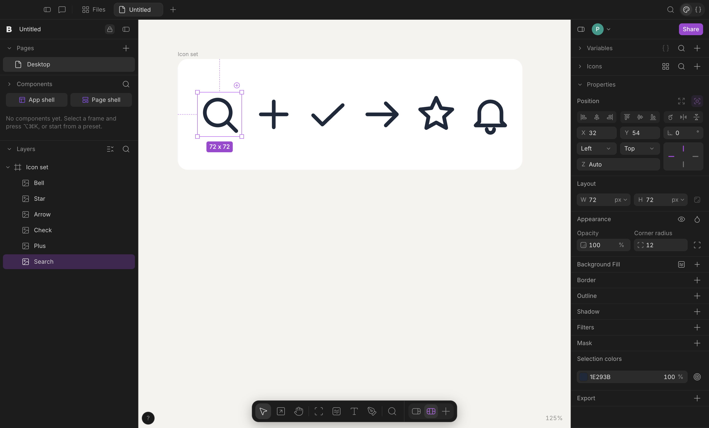
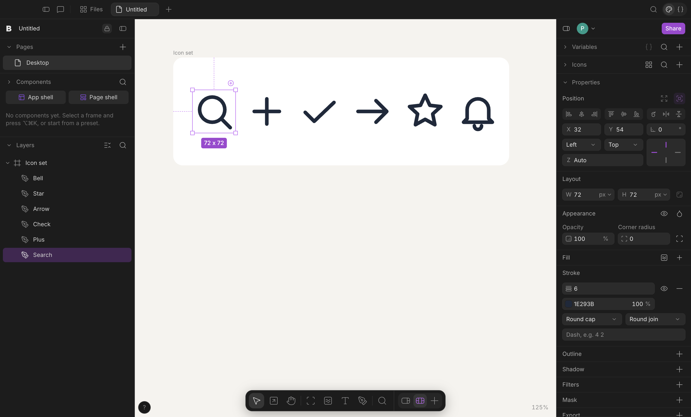
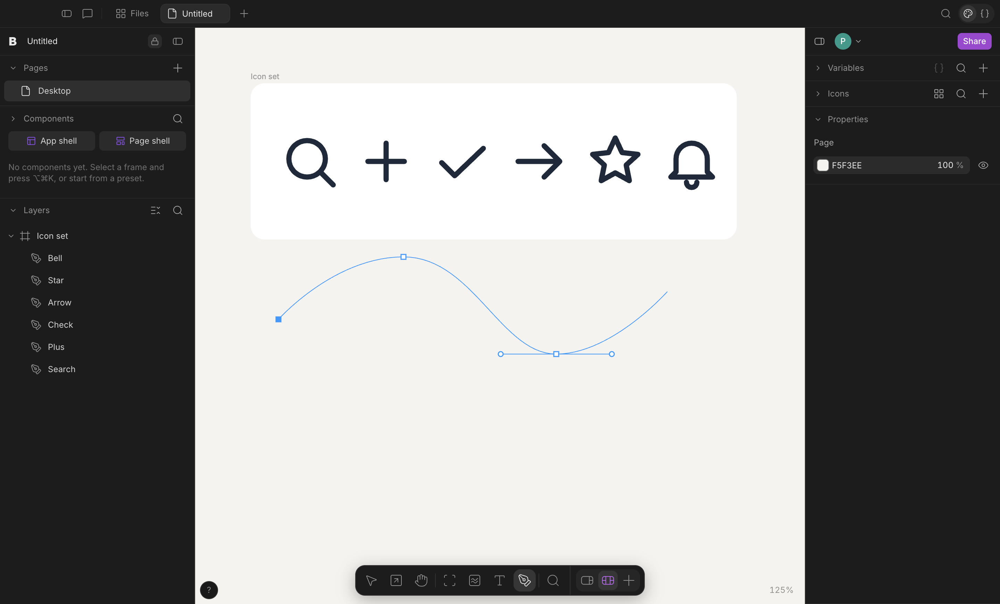
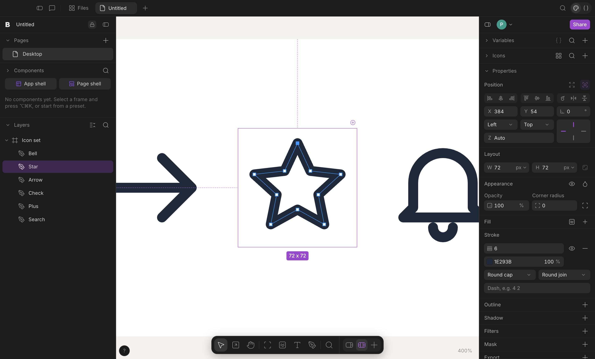

# Vector layers

A `vector` layer holds SVG path data that stays editable: drawn with the Pen tool, edited anchor by anchor, imported from
SVG (HTML, JSX, paste, drop) and written back out as inline SVG. Before this, SVG became an `image` layer
(`data:image/svg+xml`) that could only be recoloured.




## Model

```js
{
  type: "vector", id, name, parentId, x, y, w, h, rotation, flipX, flipY, opacity, blendMode, …  // normal node geometry
  viewBox: [x, y, width, height],              // the coordinate space of the paths (positive size)
  paths: [{ d: "M5 12L19 12", fillRule: "evenodd" }],  // 1–500 paths, any SVG path syntax; fillRule defaults to nonzero
  // Fill: the paint model of every layer
  color, token,                                // one solid fill (token binds a colour variable)
  fills: [ … ],                                // or a paint stack; [] means no fill
  // Stroke: the existing border fields, drawn along the path
  strokeWidth, strokeColor, strokeToken, strokeHidden,
  strokeCap: "butt" | "round" | "square",      // vector-only, optional (default butt)
  strokeJoin: "miter" | "round" | "bevel",     // vector-only, optional (default miter)
  strokeMiter: 1–100,                          // vector-only, optional (default 4)
  strokeDash: [4, 2],                          // vector-only, ≤ 16 lengths in layer pixels
}
```

- The schema lives in `web/document-core.js` (`vectorError`). `paths`, `viewBox` and the four stroke details are refused
  on other layer types. Limits per layer: 500 paths, 200,000 characters per path, 500,000 in total, 50,000 segments.
  Path data is checked with the real grammar (`VerynizeVector.pathError`, cached), so a file, an agent edit or a room
  snapshot with broken path data is rejected like any other invalid document.
- **Rendering.** The layer element is the box (position, size, rotation, flips, opacity, blend, filters, shadows as for
  any layer; `web/node-style.js` gives a vector box no background, border or radius). Inside it an `<svg>` fills the
  box with `preserveAspectRatio="none"`: resizing a layer stretches the drawing and never rewrites its paths.
- **Strokes do not scale.** Stroke width and dash lengths are layer pixels, drawn with
  `vector-effect: non-scaling-stroke`, so a non-uniform resize keeps a 2 px stroke 2 px on every side (as in Figma).
  Import converts SVG stroke widths (viewBox units) into layer pixels once, scaled to the layer's size. Strokes are
  centred on the path; inside/outside alignment is not modelled.
- **Fills.** Solid paints, linear and radial gradients (mapped like the CSS gradients other layers use, over the layer
  box) and image paints (an SVG pattern; cover/contain need the paint's natural size) render. SVG has no conic
  gradient: a conic paint on a vector draws as a linear gradient of its stops. Paints stack bottom-to-top as elsewhere.
- **Selection and hit testing** use the layer box. A layer drawn or edited on the canvas hugs its geometry (the box is
  refitted after every anchor edit, see `fitBox`); an imported SVG keeps the SVG's own box (its padding is part of
  the icon's size in a layout). A press anywhere inside the box selects the layer, as for images.

## Geometry (`web/vector-geometry.js`)

DOM-free and shared: a classic `<script>` in the renderer (before `document-core.js`) and an ES module in Node
through `integrations/vector-geometry.mjs`. `parsePath` reads every SVG command (absolute and relative M L H V C S Q
T A Z, implicit repetition, compact numbers and arc flags) and normalizes it to absolute `M`/`L`/`C`/`Z`: H/V become
lines, S/T reflect the previous control point, Q is raised to a cubic, arcs become cubics of at most 90° (endpoint
to centre parameterization with radius correction). Also exact bounds (cubic extrema), affine matrices and SVG
`transform` parsing, contours with in/out handles for editing, de Casteljau splitting, nearest-segment search,
`fitBox` (refit box and viewBox so every point stays where it is on screen, under rotation and flips) and
`svgMarkup` (the `<svg>` the canvas, HTML export, PNG/PDF and Copy as SVG draw). Stored path data is rounded to 3
decimals.

## Import (`web/vector-svg.js`)

`importSvg(markup)` uses its own small XML reader (no DOM, nothing evaluated, no external references) and flattens
the drawing into the root viewBox: `path`, `rect` (with rx/ry), `circle`, `ellipse`, `line`, `polyline`, `polygon`;
`g`, nested `svg` viewports, `symbol`/`use` (depth 8, cycles skipped), `switch`, `a`; transforms; presentation
attributes, `style` attributes and simple `<style>` rules (tag, `.class`, `#id`); `currentColor`; fill/stroke opacity
and element opacity; `display:none`/`visibility:hidden`; `preserveAspectRatio` (the layer's viewBox is the region the
viewport really shows). Consecutive shapes with the same paint share a layer.

- One paint: one vector layer the size of the SVG. Several paints: a free frame of that size with one vector per
  paint group, each hugging its geometry.
- Not representable, so the SVG stays an image layer and the import says why: gradient and pattern paints, filters,
  masks, clip paths, `<text>`, `<image>`, `foreignObject`, or more than 2,000 shapes, 200 paint groups, 200,000
  segments or 20,000 elements.
- Entry points: HTML import (`integrations/codec-html.mjs`), JSX `<svg>` (`integrations/design-edit.mjs`), and on the
  canvas pasted SVG markup, pasted `.svg` files and dropped `.svg` files (`web/vector-edit.js`; each one undo step, the
  image path takes over for what a vector cannot hold).

## JSX (`integrations/vector-jsx.mjs`)

```jsx
<svg
  data-node-id="bok.tem"
  data-node-label="Arrow"
  data-vector
  viewBox="0 0 24 24"
  fill="none"
  stroke="#0f172a"
  strokeWidth={2}
  strokeLinecap="round"
  strokeLinejoin="round"
  className="w-[24px] h-[24px]"
>
  <path d="M5 12L19 12" />
  <path d="M12 5L19 12L12 19" />
</svg>
```

`data-vector` marks Verynize's own form: stroke width and dashes are layer pixels; `fill="none"` is no fill;
`data-fills` carries a paint stack, `data-fill-token` / `data-stroke-token` bind colour tokens and
`data-stroke-hidden` a hidden stroke. Classes carry geometry only (no `bg-`, `border-` or `rounded-` on vectors). Any
other `<svg>` an agent writes is ordinary SVG and goes through the importer. Compact reads elide path data over 4 KB
as `[path data N KB]`; writing the element back (edit or replace) keeps the stored paths. An `update_elements` edit
of a vector changes only the attributes it states, and `<path>` children replace all paths. `apply_operations`
accepts `paths`, `viewBox` and the stroke details (`integrations/design-tools.mjs`); the agent instructions and the
`generate-assets` skill describe the form.

## Export

HTML export and the canvas' own export (PNG, JPG, WebP, PDF through `desktop/render.cjs`) draw the same inline SVG.
**Copy as SVG** (`edit.copySvg`, command palette) writes the selected vectors, and vectors inside selected frames, as
one standalone SVG document with paths baked into layer pixels (strokes scale with the drawing there, as other tools
expect); pasting it back gives vectors again.

## Pen tool and anchor editing (`web/vector-edit.js`)



- **Pen** (toolbar, `P`): click places a corner anchor; drag pulls symmetric handles (Alt moves only the outgoing
  handle); clicking the first anchor closes the path; Enter or Escape finishes an open path; Backspace removes the last
  anchor. The vector is created inside the free, unrotated frame under the first anchor (else at the top level), with
  no fill and a 2 px round stroke in the canvas ink colour (black on light backgrounds, white on dark), selected, as
  one undo step.
- **Anchor editing** (double-click a vector, Enter with one selected, or the `Edit anchors` command): drag anchors
  (Shift-click adds to the selection), drag handles (a smooth anchor keeps its handles in line and the other handle
  keeps its length; Alt breaks them apart), click a segment to add an anchor there (lines stay lines, curves keep their
  shape), double-click an anchor to toggle corner/smooth, Delete/Backspace removes the selected anchors (a contour with
  fewer than two anchors goes; removing everything deletes the layer). Escape, Enter or a press outside the layer
  leaves. Each drag, insertion, toggle and deletion is one undo step; undo, redo and remote edits while editing reload
  the anchors.
- Pointer work stays imperative: the overlay is one screen-space `<svg>` in `#canvas-wrap`, mapped through the layer
  `<svg>`'s `getScreenCTM()` (zoom, pan, rotation, flips), and a drag previews by writing the layer's `<path d>`
  directly; the document changes once, on release.



## Collaboration

Vector fields are ordinary node properties, so rooms sync them as per-property operations (`web/cloud-ops.js`) with
no special casing: an anchor edit is `paths`/`viewBox`/`x`/`y`/`w`/`h` operations, an inspector stroke edit is
`strokeWidth`/`strokeCap`/…; concurrent edits of different properties of one vector both survive, the same property is
last-writer-wins. `paths` is one value, so two people editing different anchors of the same path at the same moment
keep the later edit only.

## Tests

- `integrations/vector-geometry.test.mjs`: grammar, normalization, arcs, bounds, matrices, contours, splitting, fit
  under rotation and flips, markup.
- `integrations/vector-svg.test.mjs`: importer, refusals and caps, JSX round trip of every vector field, compact reads
  and edits, HTML import → export, schema limits. `integrations/import-fidelity.test.mjs` covers both outcomes for
  HTML and JSX SVG.
- `eval/fidelity/fixtures/31-foreign-svg`, `35-foreign-svg-fallback`, `36-html-svg-vectors` (codec fidelity gate).
- `tests/canvas-vectors.cjs` (Electron): rendering, inspector, layers icon, HTML/PNG/PDF export, Pen tool, anchor
  editing, undo, paste and drop, Copy as SVG, persistence.
- `tests/cloud-vectors.mjs` (workerd): two clients edit one vector at once and converge.

## Known gaps

- No boolean operations, outline stroke, flatten, or vector networks (a path's anchors connect in order).
- No marquee selection of anchors, no anchor nudging with arrow keys, no snapping while drawing or editing.
- Gradients, filters, masks, clip paths and text inside an SVG keep it an image; conic fills on vectors draw as
  linear gradients; stroke alignment is always centre.
- Shadows on a vector are box shadows of the layer box (use a drop-shadow filter for a shape-following shadow).
- An SVG sized differently by CSS than by its own width/height is letterboxed for its declared size, then stretched.
