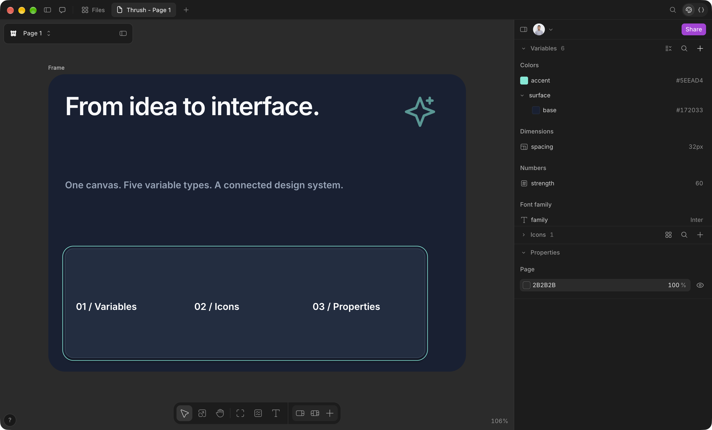
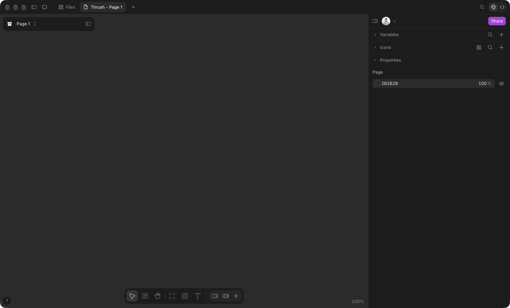
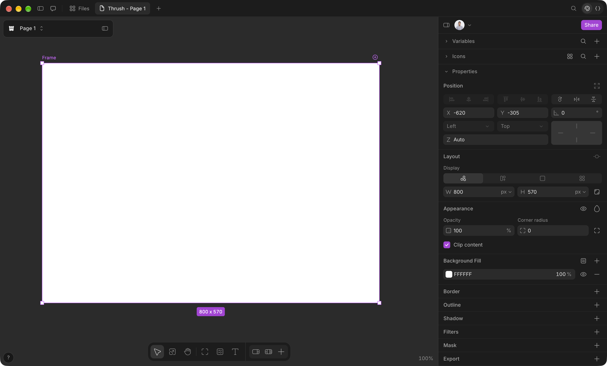
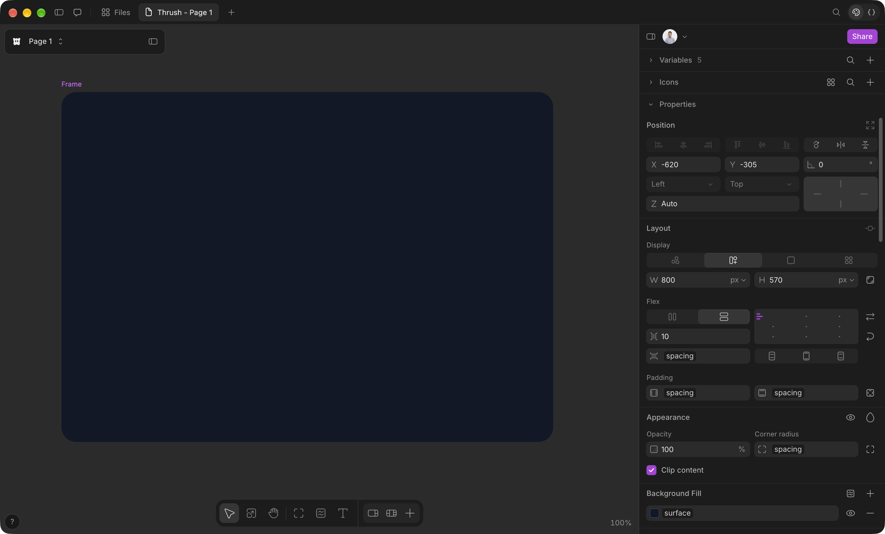
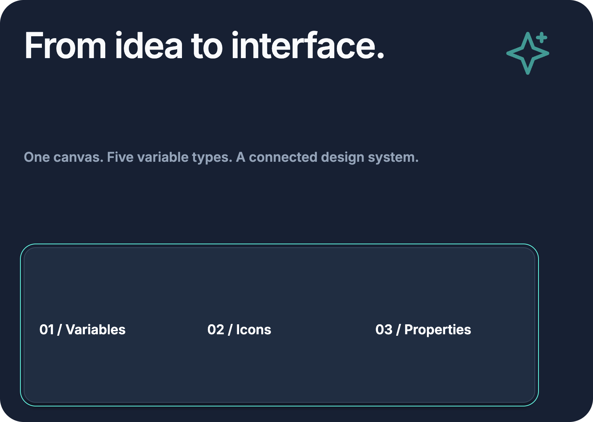
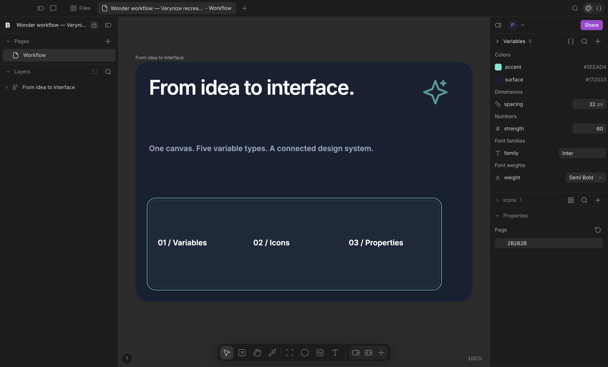

# Alur desain Wonder dan audit Verynize — 30 Oktober 2026

Dokumen ini menghubungkan eksplorasi UI Wonder, bukti gambar, audit implementasi Verynize, dan pemeriksaan regresi. Sasaran sesi adalah membuat desain dari canvas kosong sambil mencoba keluarga konfigurasi Properties, Icons, dan Variables, termasuk perubahan nilai variable setelah dipakai pada beberapa properti.

**Hasil sesi:** desain baru dibuat di Wonder melalui UI dan direkam dalam 43 screenshot (00–42) dan satu export PNG. Kelima tipe variable dipakai; fill, radius, spacing, tipografi, opacity dan warna SVG dikombinasikan dengan variable. Cakupan yang dicoba atau diterapkan meliputi flex/grid, gradient, border, outline, shadow, filter, mask, blend, radius individual dan shader; sebagian besar berstatus Diterapkan atau Terlihat, bukan Teruji. **Seluruh konfigurasi belum selesai diuji.** Daftar di bawah membedakan hasil yang diterapkan, kontrol yang hanya terlihat dan pekerjaan tersisa. Export PNG 2× berhasil dibuat dan diperiksa pada 1600×1140, mencakup ikon Spark serta seluruh artboard.

[Screenshot akhir Wonder](../design/wonder/2026-10-30/42-final-with-variable-folder.png) · [Export PNG asli 1600×1140](../design/wonder/2026-10-30/wonder-workflow.png). File aktif tetap **Thrush / Page 1**; artboard **Frame**, 800×570. Ikon **Spark** kini menjadi child absolute pada X680/Y40, sehingga ikut dalam export frame. Rename/delete/Undo variable sudah dicoba; reopen/persistensi dokumen Wonder setelah menutup aplikasi belum diuji.

## Pembagian pekerjaan

| Pelaksana | Tanggung jawab | Hasil tertulis |
|---|---|---|
| Agent utama | Kontrol Wonder, membuat desain, merekam gambar, integrasi dan validasi akhir | Dokumen ini dan `design/wonder/2026-10-30/` |
| `audit_properties` | Audit Properties dan binding nilai, perbaikan yang ditugaskan | [Audit Properties](audits/2026-10-30-properties-agent.md) |
| `audit_variables_icons` | Audit Variables/Icons, validasi nama, ekspor CSS dan penanganan ikon | [Audit Variables dan Icons](audits/2026-10-30-variables-icons-agent.md) |
| `workflow_documentation` | Inventaris cakupan, indeks bukti, batas klaim dan alur reproduksi | Dokumen ini |
| Validasi (3 agent) | Source Wonder, computer use pada Wonder, audit bukti gambar | [Ringkasan validasi](audits/2026-10-30-validation-summary.md) |

Kontrol desktop dimiliki satu pelaksana agar klik dan fokus aplikasi tidak bentrok. Agent dokumentasi tidak mengoperasikan Wonder dan tidak menafsirkan perubahan kode sebagai bukti keberhasilan UI Wonder.

## Sumber dan batas bukti

- **Baru, 30 Oktober:** screenshot dalam [`design/wonder/2026-10-30/`](../design/wonder/2026-10-30/), ditinjau bersama langkah dan hasil dari pelaksana.
- **Validasi, 30 Oktober:** screenshot v01–v32 dalam [`design/wonder/2026-10-30/validation/`](../design/wonder/2026-10-30/validation/) dan pembacaan source renderer Wonder 0.2.190. `app.asar` hanya berisi shell Electron; editor dimuat dari app.wonder.so, sehingga source dibaca dari cache browser lokal terbaru dan bisa sedikit berbeda dari build saat capture 00–42.
- **Historis, 28 Oktober:** screenshot dalam [`design/wonder/`](../design/wonder/) dan [catatan eksplorasi](../design/wonder/catatan.txt). Screenshot historis membantu menentukan kontrol yang perlu dicoba; tidak membuktikan kontrol itu dipakai pada desain sesi ini.
- **Spesifikasi terdahulu:** [Wonder canvas spec](wonder-canvas-spec.md) mencampur pengamatan screenshot, inspeksi statis, dan inferensi yang dilabeli. Nama fitur dari spesifikasi tidak otomatis menjadi hasil observasi runtime.
- **Verynize:** audit sumber, hasil tes dan screenshot Verynize harus diberi identitas terpisah. Gambar Wonder bukan screenshot produk Verynize.

Label hasil yang digunakan:

| Label | Arti |
|---|---|
| Terlihat | Kontrol atau nilai tampak pada screenshot; efek belum dibuktikan |
| Diterapkan | Ada tindakan yang dicatat dan bukti tampilan sesudahnya |
| Teruji | Nilai/efek dibandingkan sebelum–sesudah, termasuk hasil yang diharapkan |
| Historis | Bukti berasal dari eksplorasi sebelumnya |
| Belum | Belum ada bukti sesi ini |
| Tidak tersedia | Kontrol dicari pada konteks yang sesuai, tetapi tidak ditawarkan; alasan dicatat |
| Gagal | Tindakan dicoba dan hasil berbeda dari harapan; jangan dipromosikan menjadi berhasil |

## Keadaan awal dan jurnal sesi

File aktif pada baseline adalah **Thrush**, halaman **Page 1**, zoom **100%**. Canvas tampak kosong. Panel kiri dilipat. Panel kanan menampilkan Variables dan Icons yang dilipat, serta Properties → Page dengan warna `2B2B2B` dan opacity `100%`.

| Urutan | Langkah / kondisi yang dapat dibuktikan | Hasil | Bukti |
|---|---|---|---|
| 00 | Keadaan awal file Thrush / Page 1 | Canvas kosong; Properties menampilkan Page | [00-empty-canvas.png](../design/wonder/2026-10-30/00-empty-canvas.png) |
| 01 | Membuat frame dari canvas kosong | Frame putih terpilih, ukuran 800 × 570 px, X −620, Y −305, rotation 0° | [01-frame-created.png](../design/wonder/2026-10-30/01-frame-created.png) |
| 02 | Membuka create-variable menu | Frame kini memakai fill `111827` dan radius 24; menu Colors, Dimensions, Numbers, Font family, Font weight terlihat. Pembuatan masing-masing tipe belum dibuktikan oleh gambar ini | [02-variable-types.png](../design/wonder/2026-10-30/02-variable-types.png) |
| 03 | Membuat satu variable dari tiap tipe | Panel menunjukkan Variables 5: surface `#111827`, spacing `24px`, strength `0`, family `Inter`, dan weight sedang dalam field edit nama; nilai weight tidak tampak | [03-five-variable-types-created.png](../design/wonder/2026-10-30/03-five-variable-types-created.png) |
| 04 | Menyelesaikan nilai lima variable | `surface=#111827`, `spacing=24px`, `strength=1`, `family=Inter`, `weight=600` | [04-variable-values.png](../design/wonder/2026-10-30/04-variable-values.png) |
| 05 | Memasang binding fill/radius dan mengaktifkan Flex | Background Fill menampilkan chip `surface`; Corner radius menampilkan chip `spacing`; kontrol Flex aktif | [05-bound-fill-radius-flex.png](../design/wonder/2026-10-30/05-bound-fill-radius-flex.png) |
| 06 | Beralih ke Flex Column, mengikat gap dan padding | Vertical gap, horizontal padding, vertical padding sama-sama menampilkan chip `spacing`; radius tetap terikat dan fill tetap `surface` | [06-variable-mix-layout.png](../design/wonder/2026-10-30/06-variable-mix-layout.png) |
| 07 | Menambahkan judul dan mengikat tipografi | “From idea to interface.” berada pada X24/Y24, W 487.7 Hug × H 58 Hug; chip family/weight aktif, size 48px, letter spacing −1.5px, Text Fill F8FAFC | [07-bound-typography.png](../design/wonder/2026-10-30/07-bound-typography.png) |
| 08 | Menambahkan body copy dan membuka Add icon | Body “One canvas. Five variable types. A connected design system.” terlihat. Menu menawarkan Upload SVG, Paste SVG markup, Add from selection (disabled karena tidak ada selection) | [08-icon-menu.png](../design/wonder/2026-10-30/08-icon-menu.png) |
| 09 | Memasukkan ikon dan mengikat opacity | Icons 1; instance `pasted` berukuran 64×64; Colors `5EEAD4`; Opacity menampilkan chip `strength`. Ikon tampak sangat redup | [09-icon-instance.png](../design/wonder/2026-10-30/09-icon-instance.png) |
| 10 | Mengubah Numbers strength | Nilai menjadi 0.6, chip opacity tetap strength; skala persen/angka belum disimpulkan dari screenshot | [10-number-propagation.png](../design/wonder/2026-10-30/10-number-propagation.png) |
| 11 | Mengedit color dan dimension global | surface menjadi #172033 dan spacing 32px. Background berubah, radius dan inset teks ikut berubah tanpa melepas binding | [11-color-spacing-propagation.png](../design/wonder/2026-10-30/11-color-spacing-propagation.png) |
| 12 | Mengoreksi unit opacity | strength 60 membuat ikon terlihat jelas dengan opacity terikat; nilai 0.6 sebelumnya terlalu kecil untuk skala persen | [12-number-percent-corrected.png](../design/wonder/2026-10-30/12-number-percent-corrected.png) |
| 13 | Mengikat warna SVG pada color variable | Variables 6; Colors pada instance pasted menampilkan chip accent, opacity tetap strength | [13-icon-color-variable.png](../design/wonder/2026-10-30/13-icon-color-variable.png) |
| 14 | Membuat frame Grid 690×210 dan membuka konfigurasi | Grid aktif; picker track terlihat. Field 2 sedang diedit sementara preview masih 3×1; jumlah akhir belum ditentukan dari gambar ini | [14-grid-settings.png](../design/wonder/2026-10-30/14-grid-settings.png) |
| 15 | Mengisi tampilan grid dan border | Tiga track terlihat; padding 20/20, margin 0/0, radius 16, fill 1E293B, border width 1 All; gap menampilkan chip spacing | [15-grid-border-fill.png](../design/wonder/2026-10-30/15-grid-border-fill.png) |
| 16 | Menambahkan outline dan box shadow | Border 334155; outline 5EEAD4 width 1 offset 4; shadow X 0 Y 12 blur 4, hitam 25%; spread −4 masih dalam mode edit saat capture (nilai akhir dikonfirmasi pada validasi). Box aktif, Drop dan Inner shadow terlihat namun tidak diterapkan | [16-shadow-variable.png](../design/wonder/2026-10-30/16-shadow-variable.png) |
| 17 | Membuka filter menu | Blur 2 aktif; menu Layer menawarkan Blur, Brightness, Contrast, Grayscale, Hue rotation, Invert, Saturate, Sepia. Backdrop group terlihat sebagian | [17-filter-options.png](../design/wonder/2026-10-30/17-filter-options.png) |
| 18 | Menerapkan Brightness dan Linear mask | Brightness 1.1; mask Linear alpha 100 rotation 180°, handles pada canvas | [18-mask-config.png](../design/wonder/2026-10-30/18-mask-config.png) |
| 19 | Mencoba Radial mask dan Advanced | Radial aktif; Mode Auto, Repeat, Position X 0%/Y 0%, Size auto terlihat | [19-radial-mask-advanced.png](../design/wonder/2026-10-30/19-radial-mask-advanced.png) |
| 20 | Mencoba Conic mask | Conic rotation 45°, alpha 100, handles melingkar. Invert tersedia; checkbox tampak tidak aktif saat capture | [20-conic-mask.png](../design/wonder/2026-10-30/20-conic-mask.png) |
| 21 | Menonaktifkan mask dan membuka Export | Conic row redup/hidden, komposisi utuh kembali; Export dibuka, nama Frame dan bagian konfigurasi 2x PNG terlihat di bawah | [21-export-config.png](../design/wonder/2026-10-30/21-export-config.png) |
| 22 | Membuka daftar format Export | Menu pada frame ini menawarkan PNG, JPG, WebP, PDF, Code; PNG dipilih. SVG tidak hilang: menurut source, opsi SVG hanya muncul bila seluruh selection berupa node SVG | [22-export-formats.png](../design/wonder/2026-10-30/22-export-formats.png) |
| 23 | Melepas fill variable | Background Fill menjadi literal 172033 tanpa perubahan warna; radius tetap chip spacing. Tiga label grid ditambahkan; artboard sementara 800×510 | [23-fill-detached-preserves-color.png](../design/wonder/2026-10-30/23-fill-detached-preserves-color.png) |
| 24 | Mengubah fill menjadi Linear gradient | Linear aktif dengan handles vertikal; menu menawarkan Linear/Radial/Conic; stop memakai 172033 dan 456099 | [24-gradient-types.png](../design/wonder/2026-10-30/24-gradient-types.png) |
| 25 | Mencoba Radial gradient | Radial aktif, stop 456099/172033, masing-masing 100%; pusat gradasi terlihat pada canvas | [25-radial-gradient.png](../design/wonder/2026-10-30/25-radial-gradient.png) |
| 26 | Mencoba Conic gradient | Conic aktif dengan handles melingkar dan efek warna berputar | [26-conic-gradient.png](../design/wonder/2026-10-30/26-conic-gradient.png) |
| 27 | Membuka blend menu | Normal dipilih; opsi hingga Hard light terlihat. Daftar lengkap 18 mode (lihat P14); artboard sudah kembali 800×570 | [27-blend-modes.png](../design/wonder/2026-10-30/27-blend-modes.png) |
| 28 | Menerapkan Multiply | Bagian artboard yang terlihat (canvas digulir) menjadi gelap dan tombol blend aktif | [28-multiply-applied.png](../design/wonder/2026-10-30/28-multiply-applied.png) |
| 29 | Mengedit radius individual dan membuka W mode | Radius Mixed dengan 8/32/48/32; W menu Fixed, Hug, Calculate, Add min width, Add max width. Tampilan kembali terang | [29-individual-corners.png](../design/wonder/2026-10-30/29-individual-corners.png) |
| 30 | Membuka shader library dan memilih preset | Background Fill menjadi Shifted Swirls 3; picker Background/SVG/Image dan search terlihat; parameter Gradient Center 456099, Gradient Edge 172033, Ripple Color FFFFFF, Background 000000. Radius kini 8/32/32/32: sudut keempat berubah dari 48 ke 32 setelah capture 29 tanpa catatan pelaksana | [30-shader-library.png](../design/wonder/2026-10-30/30-shader-library.png) |
| 31 | Membuka Shader settings | Gradient Aspect, Gradient Size, Ripple Density, Animation Speed, Distortion Amount, Grain Strength terlihat; nilai slider numerik tidak ditampilkan. Nama preset dan parameter dimuat dari server, sehingga tidak dapat dicek dari source lokal | [31-shader-options.png](../design/wonder/2026-10-30/31-shader-options.png) |
| 32 | Mengembalikan komposisi solid dan membuka Icons grid | Artboard 800×570, label 01/Variables–02/Icons–03/Properties dan ikon terlihat utuh; shader dinonaktifkan. Fill dan radius tidak tampak di capture ini; binding ulang baru terbukti pada 35–36. Icons 1 menampilkan thumbnail | [32-restored-bindings-icons-grid.png](../design/wonder/2026-10-30/32-restored-bindings-icons-grid.png) |
| 33 | Mencari ikon dengan query Spark | Search Spark aktif dan thumbnail tetap tampil, bukti tidak langsung bahwa asset bernama Spark. Rename pasted → Spark melalui Rename/F2 lalu Enter dikonfirmasi pelaksana melalui Accessibility; nama Spark terlihat langsung pada 39–40 | [33-icon-search.png](../design/wonder/2026-10-30/33-icon-search.png) |
| 34 | Capture akhir komposisi | Desain solid dengan enam variable, ikon Spark, judul/body dan panel tiga label; tidak ada selection. Ini screenshot UI, bukan file export | [34-final-design.png](../design/wonder/2026-10-30/34-final-design.png) |
| 35 | Rename color variable dengan F2 | surface menjadi surface/base; Background Fill tetap bound dan chip menampilkan base | [35-variable-rename-reference.png](../design/wonder/2026-10-30/35-variable-rename-reference.png) |
| 36 | Search variable dan folder | Query surface menampilkan folder surface → base dengan nilai #172033; binding tetap base | [36-variable-folder-search.png](../design/wonder/2026-10-30/36-variable-folder-search.png) |
| 37 | Menghapus variable yang dipakai | Hasil search surface menjadi kosong; Fill berubah ke literal 172033, warna artboard tetap | [37-delete-bound-variable.png](../design/wonder/2026-10-30/37-delete-bound-variable.png) |
| 38 | Undo penghapusan variable | Cmd+Z mengembalikan folder surface/base dan chip binding base, warna tetap | [38-undo-restores-binding.png](../design/wonder/2026-10-30/38-undo-restores-binding.png) |
| 39 | Rotation dan Flip Horizontal ikon | Spark terlihat miring dan mirrored; inspector setelah flip menunjukkan −15°. Pelaksana kemudian memulihkan 0°/unflipped | [39-icon-transform.png](../design/wonder/2026-10-30/39-icon-transform.png) |
| 40 | Memindahkan ikon ke dalam artboard | Cut → pilih frame → paste membuat child; setelah melepas Locked to layout, ikon absolute X680/Y40, rotation 0; Colors accent/Opacity strength bertahan | [40-icon-absolute-child.png](../design/wonder/2026-10-30/40-icon-absolute-child.png) |
| 41 | Export PNG asli | Filename wonder-workflow, scale 2×, format PNG; toast Exported 1 element. File 1600×1140 tersimpan dan mencakup Spark | [41-export-success.png](../design/wonder/2026-10-30/41-export-success.png) |
| 42 | Capture akhir setelah rename/Undo/export | Komposisi lengkap dengan folder surface/base, enam variable dan satu ikon | [42-final-with-variable-folder.png](../design/wonder/2026-10-30/42-final-with-variable-folder.png) |

Pelaksana menggunakan kontrol UI native macOS melalui Accessibility/CGEvent, lalu mengambil screenshot window Wonder. Percobaan awal belum memfokuskan Wonder; setelah aplikasi dijadikan frontmost, frame berhasil dibuat dan capture 01 diganti dengan hasil yang terverifikasi. Tidak ada kode atau state internal Wonder yang digunakan untuk menyusun desain.

Pada frame baru, inspector menampilkan:

- **Position:** alignment, rotate/flip, X −620, Y −305, rotation 0°, anchor Left/Top, Z Auto, constraint widget.
- **Layout:** empat opsi Display, W 800 px, H 570 px, aspect-ratio control.
- **Appearance:** opacity 100%, radius 0, per-corner control, Clip content aktif, visibility dan blend controls.
- **Background Fill:** `FFFFFF`, 100%, visibility, remove, add dan shader controls.
- **Border, Outline, Shadow, Filters, Mask, Export:** judul dan tombol tambah terlihat; parameter di dalamnya belum dibuka pada capture ini.

## Binding yang sudah diterapkan

Pelaksana mengamati bahwa klik pada input angka menampilkan saran variable yang kompatibel. Memilih `spacing 24px` mengganti tampilan angka dengan chip nama variable. Untuk warna, jalurnya **Choose color → Variables → surface**. Pada capture 06, frame yang sama memakai `surface` untuk background dan `spacing` untuk radius, horizontal padding, vertical padding serta vertical gap. Capture 11 kemudian menunjukkan propagasi saat `surface` diubah menjadi `#172033` dan `spacing` menjadi `32px`: background, radius, padding, dan jarak content berubah. Persistensi setelah reopen masih memerlukan bukti tambahan.

| Variable | Tipe dan nilai akhir yang dicatat | Properti yang sudah terikat |
|---|---|---|
| surface/base | Colors, `#172033`; nama awal surface | Background Fill frame, referensi tetap setelah rename 35 dan Undo 38 |
| spacing | Dimensions, `32px` | Corner radius, horizontal padding, vertical padding, vertical gap; gap grid pada 15 |
| strength | Numbers, `60` | Opacity ikon; memakai skala persen, bukan fraksi 0–1 |
| family | Font family, `Inter` | Font family judul, capture 07 |
| weight | Font weight, `600` | Font weight judul, capture 07 |
| accent | Colors, `#5EEAD4` | Colors SVG ikon, capture 13 |

### Peta tipe variable → properti (dari source)

Pembacaan source renderer menunjukkan properti yang dapat menerima tiap tipe variable. Peta ini berasal dari kode, bukan dari percobaan UI, kecuali yang sudah tercatat di tabel atas.

| Tipe | Properti yang dapat di-bind |
|---|---|
| Colors | Fill solid, stop gradient, Text Fill, border per sisi, outline, warna box/text/drop shadow, Colors SVG satu warna |
| Dimensions | W/H, min/max, padding, gap, radius uniform dan per-corner, font size, line height, letter spacing (min 0, sehingga −1.5 tidak dapat diwakili) |
| Numbers | Hanya Opacity (input 0–100, dibagi 100) |
| Font family / Font weight | Family dan weight teks |
| Tidak dapat di-bind | Margin, border/outline width, shadow blur/spread, filter, shader |

### Catatan unit opacity

Pada capture 09–10, ikon sangat redup saat Numbers `strength` bernilai 1 lalu 0.6. Capture 12 mengoreksi nilai menjadi 60 dan ikon terlihat dengan jelas. Input opacity menggunakan skala persen: untuk 60% gunakan 60, bukan 0.6. Source mengonfirmasi bahwa nilai dibagi 100. Pelajaran ini perlu dibawa ke audit Verynize sebagai pemeriksaan unit, bukan menganggap semua Numbers dinormalisasi 0–1.

### Filter, mask dan unit parameter

Menurut pelaksana, percobaan Brightness menggunakan 110 sempat dibatasi UI menjadi 3 (source mengonfirmasi batas maksimum 3), lalu dikoreksi ke 1.1. Capture 18–21 menampilkan 1.1. Artinya opacity dan brightness memiliki skala input berbeda; nilai harus mengikuti property, walaupun sama-sama berupa angka.

Mask Linear, Radial, dan Conic diterapkan berurutan pada panel grid yang sama (18–20). Pelaksana juga mencoba Invert, tetapi capture 20 menunjukkan checkbox kembali tidak aktif. Pada 21, mask disembunyikan melalui visibility sehingga bentuk panel kembali utuh. Keberadaan pilihan Advanced tidak membuktikan seluruh kombinasi Mode, Repeat, Position dan Size telah diuji.

Percobaan binding blur shadow tidak menghasilkan chip variable pada capture 16: nilai yang terlihat tetap 4. Source mengonfirmasi bahwa shadow blur/spread memang tidak dapat di-bind. Catatan ini dipertahankan meskipun filename mengandung kata `variable`; nama file tidak digunakan untuk menyatakan keberhasilan binding.

### Detach, gradient dan radius individual

Capture 23 mengonfirmasi bahwa pelepasan color variable mempertahankan warna resolved `172033`; inspector menampilkan literal warna, sementara radius masih memakai `spacing`. Hasil ini mendukung perilaku yang dituju perbaikan Verynize pada detach color binding.

Fill gradient dicoba sebagai Linear, Radial dan Conic (24–26), terpisah dari gradient **mask** (18–20). Dua stop berwarna `172033` dan `456099`; Add Stop dan opacity stop terlihat, tetapi penambahan stop tidak ditunjukkan. Blend menu 27 memperlihatkan Normal, Darken, Multiply, Plus darker, Color burn, Lighten, Screen, Plus lighter, Color dodge, Overlay, Soft light dan Hard light. Source dan validasi UI menunjukkan total 18 mode; enam sisanya adalah Difference, Exclusion, Hue, Saturation, Color dan Luminosity. Capture hanya membuktikan Multiply diterapkan dan efek gelapnya pada bagian artboard yang terlihat (28).

Capture 29 memperlihatkan radius individual 8/32/48/32 serta label Mixed. Ini membuktikan edit per-corner, tetapi belum semantik pemasangan ulang binding scalar di atas nilai per-corner tersebut. Capture 30–31 sudah menunjukkan 8/32/32/32 tanpa langkah tercatat yang menjelaskan perubahan sudut keempat. Pada capture 23–26 tinggi artboard sementara 510 memotong bagian bawah grid; capture 27–29 kembali 570. Keadaan sementara ini tidak boleh digunakan sebagai bukti layout akhir yang lolos pemeriksaan.

### Rename, delete, Undo dan export akhir

Color variable `surface` di-rename menjadi `surface/base` melalui F2. Capture 35–36 menunjukkan folder `surface` dengan anak `base`; binding fill mengikuti nama baru tanpa perubahan warna. Source menjelaskan alasannya: binding merujuk ID variable, bukan nama. Delete pada 37 menghapus entri library dan mengubah fill menjadi literal `172033`. Cmd+Z pada 38 mengembalikan variable serta binding. Ini membuktikan Undo untuk delete variable, belum seluruh jenis Undo/Redo.

Ikon sebelumnya sibling artboard, lalu dipindahkan melalui Cut → pilih frame → Paste. Pelaksana mencatat posisi awal di flex flow Y576 (tidak ada capture untuk posisi ini), kemudian memakai toggle Locked to layout untuk membuat child absolute. Capture 40 menunjukkan X680/Y40, rotation 0 dan warna/opacity masih bound. Capture 41 memperlihatkan export 2× PNG berhasil; file `wonder-workflow.png` diukur 1600×1140 dan diperiksa visual: judul, body, ketiga label dan Spark seluruhnya berada dalam gambar. Tidak ada chrome/selection UI pada export.

## Latihan lanjutan untuk menutup cakupan

Bagian ini merupakan rancangan perluasan latihan, bukan klaim bahwa semua elemennya ada pada desain akhir. Komposisi sesi ini sudah memiliki artboard, judul/body, panel grid dengan tiga label, dan ikon. Untuk menutup cakupan yang tersisa, tambahkan contoh efek terpisah di sampingnya. Konfigurasi yang saling menggantikan, seperti mode layout atau jenis fill, dicoba berurutan atau di node berbeda agar efeknya dapat dibandingkan.

| Elemen | Tujuan desain | Konfigurasi yang dicoba |
|---|---|---|
| Artboard utama | Permukaan dashboard | Ukuran, background, padding, radius, clip, border |
| Header + judul/body | Hierarki teks | Family, weight, size, line height, letter spacing, Text Fill |
| Baris aksi dengan ikon | Aksi utama dan pendukung | Flex direction/alignment/gap, Icon library, token warna |
| Grid kartu | Kelompok proyek/status | Grid tracks, row/column gap, spans, Fill/Hug/fixed |
| Badge status | Aksen sederhana | Radius, opacity, fill, inset/outer shadow |
| Papan contoh di samping | Membandingkan efek yang tidak cocok diterapkan bersamaan | Gradient/image/shader fill, border per-side, outline, filters, mask, blend |

Contoh token latihan (usulan nilai, bukan nilai yang telah dimasukkan): Colors `brand/primary`, `surface/base`, `text/primary`; Dimensions `space/md`, `radius/card`, `type/body`; Numbers `opacity/muted`; Font family `font/body`; Font weight `weight/heading`. Nama dan unit akhir mengikuti kontrol Wonder yang benar-benar tersedia.

## Checklist Properties

Kolom status merupakan hasil **sesi 30 Oktober**, bukan dukungan fitur di Verynize. Sumber H adalah screenshot historis; S adalah spesifikasi terdahulu. Sizing, layout anak, tipografi, dan warna SVG memerlukan jenis node/konteks yang sesuai.

| ID | Keluarga dan kontrol yang perlu dicoba | Cara membuktikan efek | Dasar inventaris | Status sesi |
|---|---|---|---|---|
| P01 | Page background: warna, opacity, visibility | Ubah satu nilai, bandingkan canvas, pulihkan | Baseline baru | Terlihat |
| P02 | Position X/Y dan rotation | Nilai inspector cocok dengan perpindahan/rotasi node | H43, S §3 | Frame X −620/Y −305; ikon absolute child X680/Y40 rotation 0 pada 40; rotation diterapkan 39 (hanya capture sesudah) |
| P03 | Align L/C/R dan T/M/B, distribusi | Beberapa node menunjukkan posisi/spacing berubah sesuai aksi | H43, S §2 | Terlihat pada 01; belum diuji |
| P04 | Rotate 90°, flip horizontal/vertical | Gunakan bentuk/ikon asimetris supaya hasil jelas | H43, S §3 | Ikon rotation 15 lalu Flip Horizontal 39 menampilkan −15; pulih 0/unflipped 40. Rotate 90/Flip V belum |
| P05 | Anchors Left/Right dan Top/Bottom; constraint widget | Resize parent dan periksa hubungan anak | H43, S §3 | Terlihat pada 01; belum diuji. Source tidak menyediakan anchor Center |
| P06 | Z / Auto dan absolute positioning | Node tumpang tindih; ubah urutan dan posisi dalam parent flow | H43, S §3 | Ikon dipindah menjadi child absolute 40; Z Auto terlihat, z-order belum diuji |
| P07 | Display Freeform, Flex, Block, Grid | Capture tiap mode serta perpindahan child | H43, S §3 | Flex 05, Column 06, Grid 14–15 diterapkan; Freeform/Block belum dibandingkan |
| P08 | W/H fixed px, relative %, Hug, Fill, Auto | Catat mode yang tersedia per parent/node; resize parent/content | H25, H43, S §1 | Frame fixed 800×570, transient H 510 lalu 570; judul Hug 07; W mode Fixed/Hug/Calculate terlihat 29 |
| P09 | Min/max width/height; aspect ratio; Calculate bila ditawarkan | Resize melewati batas; ratio tetap; tulis jika Calculate tidak tersedia | S §1/§3 | Calculate dan Add min/max width terlihat 29; belum diterapkan |
| P10 | Flex direction, wrap bila tersedia, align, justify, gap | Bandingkan susunan paling sedikit tiga child | S §1/§3 | Column diterapkan dan vertical gap terikat spacing pada 06; layout child belum diuji |
| P11 | Grid columns/rows, gap X/Y, child spans | Grid berisi beberapa item menunjukkan track dan span berubah | S §1/§3 | Grid frame 14–15 dengan tiga track dan gap bound; spans belum. Auto-flow: Tidak tersedia sebagai kontrol inspector menurut source |
| P12 | Padding/margin uniform, per-axis, per-side | Nilai di tiap sisi terlihat pada jarak child/parent | S §1/§3 | Padding X/Y terikat spacing pada 06; margin/per-side belum |
| P13 | Visibility dan opacity | Toggle lalu pulihkan; turunkan opacity dengan backdrop pembanding | H43 | Opacity ikon bound strength 09–10; visibility belum diuji |
| P14 | Blend mode (18 mode) | Dua layer berwarna saling tumpang tindih; capture pilihan dan efek | S §1/§3 | Menu 27, Multiply diterapkan 28, tampilan normal kembali 29; 17 mode lain belum, termasuk Difference, Exclusion, Hue, Saturation, Color, Luminosity |
| P15 | Radius uniform dan per-corner | Bandingkan sudut yang berbeda; kemudian coba binding dimension | H43 | Bound spacing 05–06; per-corner 8/32/48/32 pada 29, menjadi 8/32/32/32 pada 30–31 tanpa langkah tercatat |
| P16 | Clip content / overflow | Child sengaja melewati batas parent, toggle dan bandingkan | H43, S §1 | Terlihat pada 01; belum diuji |
| P17 | Font family, weight, size | Teks terpilih menunjukkan nilai dan perbedaan tipografi | H25–27 | Judul: family/weight binding aktif, size 48px pada 07 |
| P18 | Line height Auto/px, letter spacing | Gunakan teks beberapa baris dan cukup panjang | H25 | Judul: line height Auto, letter spacing −1.5px pada 07; multi-line belum |
| P19 | Text horizontal/vertical alignment; advanced typography | Frame teks lebih besar dari content; capture menu lanjutan | H25, S §3 | Left/top terlihat pada 07; opsi lain/advanced belum |
| P20 | Text Fill dan Background Fill: warna, opacity, visibility, tambah/hapus paint | Teks dan background berbeda; periksa paint individual | H23, H25, H43 | Background bound surface 05–06; Text Fill F8FAFC 07; paint stack belum |
| P21 | Color picker: Custom/Variables, hue, alpha, channel, format, eyedropper | Konversi format mempertahankan warna; binding tampil setelah pilih variable | H23, S §3 | Color binding melalui Variables 05; format/eyedropper belum |
| P22 | Gradient linear/radial/conic; stop, posisi, opacity | Capture editor stop dan hasil visual masing-masing jenis yang tersedia | S §1/§3 | Linear 24, Radial 25, Conic 26 dengan dua stop 172033/456099; Add Stop terlihat, belum diuji |
| P23 | Image fill: Fill/Cover/Contain/None | Gunakan rasio gambar dan frame berbeda, periksa crop/stretch | S §1 | Belum. Scale down hanya ada pada object-fit node image, bukan image fill |
| P24 | Shader fill/node: preset dan parameter | Pilih preset, ubah satu parameter; simpan sebelum–sesudah | H55–56, S §3 | Shifted Swirls 3 diterapkan 30 lalu dinonaktifkan 32; settings 31 hanya diamati, slider tidak diubah |
| P25 | Border: warna, opacity, width uniform/per-side, style bila tersedia | Border kontras; tiap sisi dibedakan | H43, S §1 | Border 1px All; warna 334155 pada 16; per-side/style belum |
| P26 | Outline | Ubah width/offset/color yang ditawarkan dan capture hasil | H43 | Outline 1px, offset 4, warna 5EEAD4 pada 16 |
| P27 | Shadow Box/Inner/Drop, serta Text untuk node teks; tambah/hapus dan parameter | Capture jenis yang tersedia dan efek pada bentuk/teks | H43, S §1 | Box shadow X 0/Y 12/blur 4/spread −4/hitam 25% pada 16; Drop/Inner hanya terlihat; Text belum |
| P28 | Filters: blur, brightness, contrast, grayscale, hue rotate, invert, saturate, sepia | Gunakan contoh berwarna; catat satu hasil tiap filter yang tersedia | H43, S §1 | Blur 2 pada 17 lalu Brightness 1.1 pada 18–21; menu Layer/Backdrop diinventaris, opsi lain belum diterapkan. Drop shadow bukan filter, melainkan tipe Drop pada Shadow (P27) |
| P29 | Mask dan pelepasan mask | Bentuk pemotong dan target jelas; capture sebelum/sesudah | H52, S §2 | Linear 180°, Radial Advanced, Conic 45° pada 18–20; visibility off 21. Invert dicoba menurut pelaksana, off saat 20. Belum: mask Image/Custom, Mode Alpha/Luminance, Add/Subtract/Intersect/Exclude, Detach mask as shape |
| P30 | Icon / SVG Colors (kontekstual) | Ubah warna path/stroke; bedakan dengan background bounding box | S §3 | Colors SVG bound accent pada 13; path turquoise nyata pada 12–13 |
| P31 | Scale tool (kontekstual) | Ukuran, stroke/radius/font ikut berubah sesuai kontrol yang ditawarkan | S §2/§3 | Belum; kontrol terlihat pada validasi |
| P32 | Export format, scale, prefix dan output | Capture pengaturan, file output dan dimensi; buka output | H45–50 | PNG 2× berhasil 41, output 1600×1140 diperiksa; format lain hanya menu 22. Source juga menyediakan skala 0.5×–4×, 720p–2160p, 512w/512h, Code Tailwind/CSS, dan SVG untuk selection SVG |

Untuk dropdown dengan banyak opsi, catat daftar yang muncul, opsi yang benar-benar diterapkan, dan alasan opsi tersisa belum dicoba. “Semua konfigurasi” tidak boleh disimpulkan hanya dari daftar keluarga di atas.

## Checklist Variables dan mix-and-match

Screenshot historis H42 menunjukkan lima kategori: **Colors, Dimensions, Numbers, Font family, Font weight**. H41 memperlihatkan nama dalam folder `brand`. Dukungan binding suatu properti perlu dikonfirmasi lewat picker properti tersebut; peta dari source ada di bagian Binding.

| ID | Percobaan | Hasil yang harus dicatat | Status sesi |
|---|---|---|---|
| V01 | Buka create menu dan tiap kategori | Nama kategori, field nilai, unit/default | Terlihat: menu 02; detail tiap tipe belum |
| V02 | Buat color variable dan folder/nama dengan slash | Nilai tersimpan, pengelompokan, nama saat dipilih | Color surface #111827 dibuat 03, berubah 172033, rename folder surface/base 35–36 |
| V03 | Buat dimension variable | Nilai dan unit; daftar properti kompatibel | spacing 24px dibuat 04, terikat radius/gap/padding 06 |
| V04 | Buat number variable | Range dan unit; batas saat dipakai opacity/angka lain | strength akhir 60 pada 12; dipakai opacity ikon. Source: Numbers hanya dapat di-bind ke Opacity |
| V05 | Buat family dan weight variable | Nama family dan nilai weight yang diterima | family Inter dan weight 600 dibuat 04, keduanya bound ke judul 07 |
| V06 | Search/filter/grid atau list yang ditawarkan | Hasil pencarian nama serta reset pencarian | Search surface menampilkan folder base 36; hasil kosong saat delete 37; reset akhir 42. Source: search hanya mencocokkan nama, bukan nilai |
| V07 | Rename, duplicate, delete yang ditawarkan | Referensi lama tetap konsisten atau perilaku pelepasan yang terlihat | Rename surface → surface/base 35, delete 37, Undo 38. Duplicate: Tidak tersedia; menu konteks hanya Rename, Reference variable, Delete (validasi v25) |
| V08 | Bind satu color ke fill pada dua node berbeda | Kedua node menampilkan warna yang sama serta indikator binding | Belum |
| V09 | Bind color yang sama pada Text Fill dan background | Setelah edit token, warna teks dan frame sama-sama berubah | Belum |
| V10 | Bind dimension ke radius, gap, padding, ukuran/font size yang kompatibel | Satu variable mengontrol lebih dari satu properti sesuai picker | spacing terikat radius/padding X/Y/gap 06; edit 24 → 32 terpropagasi 11 |
| V11 | Bind number ke opacity atau properti angka kompatibel | Nilai hasil dan normalisasi persen/angka jelas | strength → opacity teruji 09–12; gunakan 60 untuk 60%, bukan 0.6 |
| V12 | Bind family + weight + size pada teks yang sama | Ketiga binding tetap aktif bersamaan | family + weight bound bersamaan pada 07; size masih literal 48px. Source: font size dapat di-bind ke Dimensions, belum dicoba |
| V13 | Literal override lalu bind kembali | Nilai dan indikator sesuai sumber nilai yang aktif | Fill bound → detach 23 → bind kembali, terbukti oleh chip base pada 35–36 |
| V14 | Bind scalar saat per-side/per-corner/per-axis aktif | Catat apakah override dibersihkan, dipertahankan, atau UI menolak | Radius bound → individual 29 → bound spacing lagi; chip spacing pada radius terlihat pada 35–38 |
| V15 | Edit variable global setelah dipakai beberapa node | Capture sebelum–sesudah; identifikasi semua node yang berubah | surface #111827 → #172033 dan spacing 24 → 32 terpropagasi 11; validasi mengulang spacing/accent/strength lalu Undo |
| V16 | Detach variable | Tampilan sebelum dan sesudah; apakah nilai resolved dipertahankan | Color detach 23 mempertahankan 172033; numeric detach belum. Source: detach skalar tidak mengubah nilai, bukti UI masih diperlukan |
| V17 | Hapus variable yang masih dipakai | Perilaku pengguna nyata: fallback, detach, dialog, atau penolakan | Delete used color 37 mempertahankan 172033 sebagai literal |
| V18 | Undo/redo edit, bind, detach | Nilai, binding, dan tampilan kembali konsisten | Cmd+Z Undo delete mengembalikan variable folder + binding 38; Redo/edit/bind undo belum |
| V19 | Simpan/reopen serta export variable jika tersedia | Binding/nama/nilai tetap; output bukan hanya screenshot | PNG desain export 41 teruji; reopen/variable CSS export Wonder belum |
| V20 | Alias variable (Reference / Change / Detach reference) | Variable merujuk variable lain; perubahan sumber ikut terpropagasi | Belum; menu Reference variable terlihat pada validasi v25 |
| V21 | Rename/delete grup folder | Semua anggota folder dan binding-nya tetap konsisten | Belum |

Percobaan yang paling menentukan untuk Verynize adalah **V14** dan **V16**: audit kode awal menemukan potensi konflik antara binding scalar dengan override individual, serta pelepasan color binding yang dapat mengembalikan warna lama. Audit dan pengujian Verynize tetap terpisah dari perilaku Wonder sampai sesi UI mengonfirmasinya.

## Checklist Icons

Baseline baru memperlihatkan header Icons dengan tombol view, search dan add. Menu add dan isi library belum dibuktikan oleh baseline. Jangan menganggap opsi Verynize sama dengan opsi Wonder. Menurut source, binding warna ikon hanya berlaku untuk SVG yang dapat diubah ke `currentColor` (satu paint); SVG multicolor diedit per warna.

| ID | Percobaan | Bukti yang diperlukan | Status sesi |
|---|---|---|---|
| I01 | Expand Icons dan buka Add | Menu penuh, kategori/set/import yang benar-benar tersedia | Menu 08: Upload SVG, Paste SVG markup, Add from selection (disabled) |
| I02 | Pilih/tambah ikon yang tersedia | Nama set dan ikon, preview, item library | Satu asset pasted terlihat 09; alur input mengikuti catatan pelaksana |
| I03 | Grid/list, search dan clear | Hasil pencarian serta perubahan tampilan panel | Grid 32, search Spark 33; list view tersedia dan aktif pada validasi v28; reset belum |
| I04 | Masukkan ikon pada canvas / parent | Node hasil, ukuran, tipe/konteks Properties | Instance Spark 64×64 kini child absolute X680/Y40 pada 40, ikut export 41 |
| I05 | Resize/rotate/flip ikon | Hasil dengan bentuk asimetris dan nilai inspector | Rotate 15 + Flip Horizontal 39, lalu 0/unflipped 40; resize/Flip V belum |
| I06 | Ubah warna ikon melalui Properties | Path/stroke berubah, bukan hanya background kotak | Warna path turquoise terlihat 12; Colors SVG bound accent 13 |
| I07 | Bind warna ikon ke color variable jika ditawarkan | Picker, indikator binding, perubahan global, hasil ikon | Colors chip accent dan opacity strength bersamaan pada 13; edit accent dicoba lalu di-undo pada validasi |
| I08 | Ikon yang sama pada dua komponen | Periksa apakah instance ikut update atau berupa salinan mandiri | Belum |
| I09 | Rename/delete asset yang dipakai | Dampak ke instance dan Undo | Rename pasted → Spark melalui F2/Enter dikonfirmasi pelaksana; nama terlihat pada 39–40; delete/Undo belum |
| I10 | Export ikon dan komposisi | Ikon tetap terlihat pada file output | PNG 2× 41 dan wonder-workflow.png menyertakan Spark setelah menjadi child absolute pada 40 |
| I11 | Replace SVG, Copy SVG/Copy name, Select occurrences, Change/Link icon, Detach from library | Hasil tiap aksi pada asset dan instance | Belum; tersedia menurut source |

## Bukti historis untuk inventaris

| ID | File | Yang benar-benar tampak / fungsi referensi |
|---|---|---|
| H23 | [Color picker](../design/wonder/23-color-picker.png) | Solid/gradient/image controls, Custom/Variables, HSV surface, alpha dan input warna |
| H25 | [Typography](../design/wonder/25-typography.png) | Teks, family Inter, Regular, 32 px, line height Auto, letter spacing, alignment |
| H26–27 | [Family picker](../design/wonder/26-font-family-picker.png), [Weight picker](../design/wonder/27-font-weight-picker.png) | Referensi menu tipografi; bukan percobaan ulang sesi ini |
| H41–42 | [Variables](../design/wonder/41-variables.png), [Create variable](../design/wonder/42-new-variable-menu.png) | Folder `brand` dan lima tipe variable |
| H43 | [Frame Properties](../design/wonder/43-frame-properties.png) | Position, Layout, Appearance, Fill, Border, Outline, Shadow, Filters, Mask, Export |
| H45–50 | [Export options](../design/wonder/45-export-options.png), [Format](../design/wonder/46-export-format.png), [Saved](../design/wonder/50-export-success.png) | Referensi opsi dan keberhasilan export pada sesi lama |
| H52 | [Mask options](../design/wonder/extra/52-mask-options.png) | Referensi menu mask |
| H55–56 | [Shader](../design/wonder/55-shader-created.png), [Presets](../design/wonder/56-shader-presets.png) | Referensi node dan picker shader |
| H89 | [Desain eksplorasi lama](../design/wonder/89-final-design.png) | Hasil sesi 28 Oktober; tidak digunakan sebagai hasil desain baru |

## Dari observasi ke implementasi Verynize

Setiap perbaikan harus menghubungkan empat hal: tindakan pengguna, perilaku yang diharapkan, lokasi implementasi, dan bukti regresi. Audit kode dapat membuktikan bug internal tanpa harus mengklaim perilaku Wonder identik.

| Perubahan Verynize | Hasil bagi pengguna | Bukti / validasi |
|---|---|---|
| Detach color variable mempertahankan nilai resolved dan alpha | Warna tidak kembali ke literal lama; multi-selection memakai warna masing-masing | [Audit Properties](audits/2026-10-30-properties-agent.md); `inspector-variable-binding` lulus |
| Binding uniform membersihkan override yang bertentangan | Chip radius, border, padding dan gap sesuai hasil render; cross-axis dipertahankan sesuai kontrak | `inspector-variable-binding` lulus |
| Editor radius per-corner dan border per-side | Empat nilai dapat diedit, undoable, lalu kembali ke uniform/binding | [Corners](../design/verynize/2026-10-30/01-individual-corners.png), [Border](../design/verynize/2026-10-30/02-individual-border-widths.png); regression lulus |
| Validasi color creation terhadap namespace color dan typed | Nama duplikat/reserved tidak menimpa variable yang dipakai | [Audit Variables/Icons](audits/2026-10-30-variables-icons-agent.md); `inspector-variable-library` lulus |
| CSS export menolak identifier yang bertabrakan | Nilai tidak diam-diam tertimpa pada output CSS | Integrasi variable dan UI library lulus; round-trip JSX nama ambigu tetap batas terpisah |
| Decode dan parse SVG di dalam error handler | Ikon malformed ditolak dengan notifikasi tanpa node rusak | UI library lulus; screenshot tes memperlihatkan toast expected invalid SVG |
| Colors untuk SVG monochrome sederhana | Warna bentuk asli dapat terikat variable, terpisah dari background; detach/reload/export bekerja | [SVG proof](../design/verynize/2026-10-30/svg-color-variable.png) membuktikan tint bentuk dengan variable accent, tetapi chip binding tertutup toast; uji pixel dan lifecycle lulus |
| Urutan zoom native export diperbaiki setelah loadURL | Raster 2× benar-benar memenuhi 1600×1140, bukan artwork 1× di pojok | [PNG hasil perbaikan](../design/verynize/2026-10-30/workflow-export.png), [verification](../design/verynize/2026-10-30/export-verification.json); `render-export` lulus 0.5×/1×/2×/4× |

Gaps yang perlu tetap dinyatakan: outline/filter inspector, penggantian per-warna pada SVG multicolor, struktur folder variable, rename color variable (V3 di audit Variables/Icons), alias variable, dan binding properti yang belum didukung. Implementasi baru Colors untuk SVG monochrome sederhana dijelaskan dalam audit Variables/Icons; itu bukan dukungan penuh semua SVG. Status pastinya mengikuti audit sumber terbaru dan hasil implementasi, bukan daftar lama dalam spec.

## Rekonstruksi Verynize yang dapat diedit

[Dokumen native Verynize](../design/verynize/2026-10-30/workflow.verynize.json) merupakan rekonstruksi mandiri dari komposisi yang diamati, bukan file export Wonder. Dokumen berisi delapan layer, enam variable dari lima tipe, dan ikon Spark sebagai child absolute artboard. [Catatan artefak](../design/verynize/2026-10-30/README.md) menjelaskan perbedaan: outline terpisah didekati dengan CSS shadow; Brightness dan mask tersembunyi dari Wonder tidak dimasukkan. Ini rekonstruksi fungsional, bukan klaim pixel-identical.

[Export PNG Verynize 1600×1140](../design/verynize/2026-10-30/workflow-export.png) sudah dibuat ulang setelah perbaikan skala. Agent penguji dan agent dokumentasi memeriksa gambar lengkap. [Export verification](../design/verynize/2026-10-30/export-verification.json) mencatat delapan layer, SVG tint, dimensi dan pixel opaque di area kanan/bawah yang sebelumnya kosong. [Export sebelum perbaikan](../design/verynize/2026-10-30/workflow-export-before-scale-fix.png) dipertahankan hanya sebagai bukti bug, bukan hasil akhir.

### Hasil pengujian Verynize

Hasil berikut dilaporkan agent pemegang desktop setelah build UI terbaru dan seluruh aplikasi Electron pengujian ditutup:

| Pemeriksaan | Hasil dan batas |
|---|---|
| `npm run build:ui` | Lulus pada build akhir untuk regression |
| `node tests/inspector-variable-binding.cjs` | Lulus; fill detach, undo, binding, corner individual dan border individual |
| `node tests/inspector-variable-library.cjs` | Lulus ulang pada build terbaru; validasi nama/export collision, malformed SVG, pixel warna bentuk, perubahan variable, multi-selection, reload/export/restore |
| `node tests/canvas-page.cjs` | Lulus |
| `node tests/inspector-parity.cjs` | Lulus; termasuk PNG 0.5×/4× dan PDF |
| `node tests/render-export.cjs` | Lulus 0.5×/1×/2×/4× dengan ukuran dan pixel cakupan artwork |
| Integrasi terpilih oleh agent utama | 116/116 lulus |
| Fidelity oleh agent utama | 26 fixture, 105 pemeriksaan lulus |
| `npm run check`, `npm run lint:ui`, `npm run typecheck:ui` | Lulus pada pemeriksaan akhir agent utama |

Regresi UI dan export yang relevan sudah selesai; ini tidak menyatakan seluruh `npm test` dijalankan. Rincian implementasi dan batas cakupan tetap berada dalam dokumen audit masing-masing agent.

## Validasi dan pekerjaan tersisa

Agent dokumentasi memeriksa secara visual 43 screenshot baru Wonder, PNG asli Wonder, empat screenshot Verynize dan PNG Verynize setelah perbaikan skala. Seluruh tautan lokal diperiksa. Bukti historis, Wonder sesi baru, dan produk Verynize dilabel terpisah. Hasil regression Electron di atas berasal dari agent penguji setelah giliran kontrol desktop berpindah dari Wonder.

Validasi lanjutan oleh tiga agent ([ringkasan](audits/2026-10-30-validation-summary.md)) mengonfirmasi file, artboard, posisi ikon, enam variable, seluruh binding, propagasi live (spacing/accent/strength diubah lalu di-undo) dan dimensi export. Koreksi dari [source](audits/2026-10-30-validation-source-agent.md), [computer use](audits/2026-10-30-validation-computer-use-agent.md) dan [audit bukti](audits/2026-10-30-validation-evidence-agent.md) sudah diterapkan pada dokumen ini.

| Hasil | Status |
|---|---|
| Membuat desain dari canvas kosong | Terbukti 00–42 |
| Membuat dan memakai lima tipe variable | Terbukti 04–13; dua Colors menghasilkan total enam variable |
| Mengubah variable global dan melihat perubahan properti | Terbukti 10–12; unit opacity dikoreksi ke 60 |
| Detach color mempertahankan warna | Terbukti 23, lalu binding terpasang lagi terlihat pada 35 |
| Memakai SVG Colors dan opacity variable bersamaan | Terbukti 13; asset Spark dicari pada 33 |
| Memakai semua konfigurasi yang tersedia | Belum; 64 baris checklist mencatat bagian yang hanya terlihat, tidak tersedia, atau belum dicoba |
| Undo delete variable | Terbukti 38; Redo dan reopen dokumen belum diuji |
| File export PNG | Berhasil 41; 1600×1140/2× diperiksa. PDF/JPG/WebP/Code belum diekspor |
| Hierarki ikon untuk export frame | Ikon menjadi child absolute pada 40 dan tampil dalam PNG 41 |
| Kesetaraan penuh Verynize–Wonder | Tidak diklaim; implementasi dan batas fitur dicatat di audit masing-masing |

Pekerjaan lanjutan yang masih diperlukan untuk memenuhi permintaan “semua konfigurasi”:

1. Uji keluarga Position/alignment/anchors/transform, berbagai sizing modes/min-max/Calculate, Block/Freeform layout, grid spans, margin/per-side padding, per-side border, visibility/overflow, typography lanjutan dan seluruh opsi color format.
2. Uji image fill, variasi shadow selain Box (termasuk Text), filter selain Blur/Brightness, seluruh tipe/mode/operasi mask, 17 mode blend tersisa dan perubahan parameter shader. Dropdown yang dibuka belum berarti setiap opsi diterapkan.
3. Lanjutkan binding lintas beberapa node, font size ke Dimensions, numeric detach, alias variable, rename/delete folder, Redo dan reopen; rename/delete/folder/search serta Undo delete sudah diuji 35–38. Selesaikan icon delete/instance reuse, aksi asset ikon (I11), resize/Flip V dan edit global accent yang disimpan.
4. Uji format export lain bila dibutuhkan. PNG 2× sudah berhasil setelah ikon menjadi child artboard pada 40–41; PDF/JPG/WebP/Code belum dijalankan, dan SVG memerlukan selection berupa node SVG.
5. Tinjau gap Verynize yang masih terbuka, terutama paint stack, outline/filter inspector, folder variable, rename color variable, binding per-corner/per-side dan SVG multicolor. Regresi UI/export baru sudah lulus; perubahan berikutnya memerlukan validasi sesuai cakupannya.
